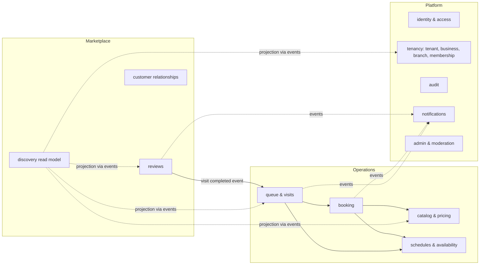
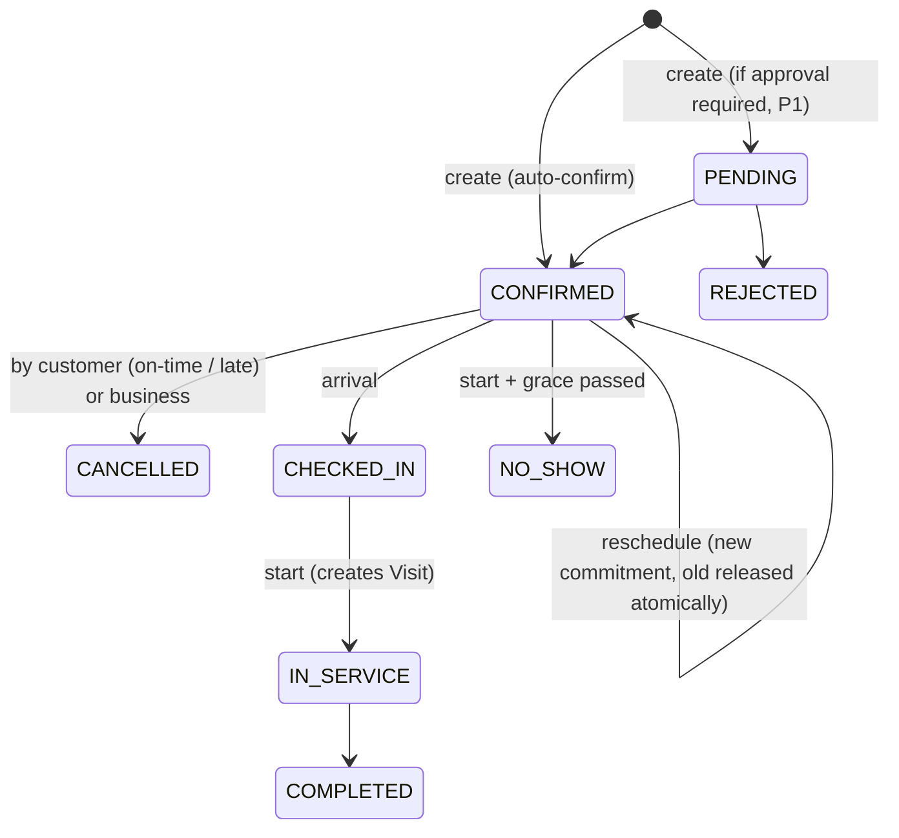
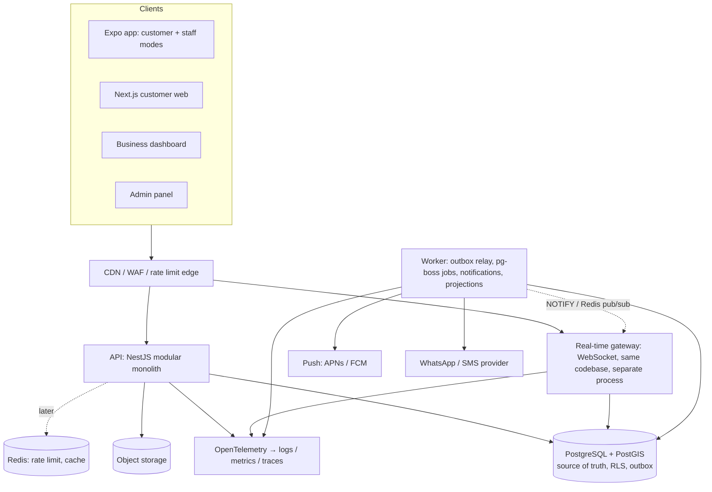

# 03 — MVP Recommendation & Practical Architecture

Version 0.1 · 2026-10-14 · Status: Draft (recommendations, pending decisions in [04](04-open-decisions.md))

---

## 1. Recommended MVP

**The MVP in one sentence:** a barbershop runs its whole floor on our staff queue board — walk-ins, remote queue joins, and appointments together. Customers nearby can see live waits, join the queue, or book. Every review comes from a real, completed visit.

### 1.1 In scope (P0)
| Surface | Scope |
|---|---|
| **Customer app** (Expo iOS/Android) + **customer web** (responsive, SEO pages) | Phone OTP; geo/manual search, list + map; live status in results; business profile; join queue / book; live queue status; history; favorites; reviews; ar/en + RTL |
| **Staff app** (same Expo app, staff mode; also usable on a tablet) | Queue board by barber lane; add walk-in; call / start / complete / no-show / skip / transfer; barber status toggle; today's appointments; create booking for a customer |
| **Business dashboard** (web) | Onboarding; branches; hours/closures; services, prices, durations; staff invites, roles, eligibility; queue & booking policies; basic analytics; review replies |
| **Admin panel** (web, internal) | Business verification; suspend; moderation (reviews, photos); categories/settings; audit log viewer |
| **Platform** | Multi-tenant isolation (RLS); audit log; notifications (push + WhatsApp/SMS for critical events); rate limiting; observability; backups |

### 1.2 Explicitly deferred
Payments/deposits (P1), kiosk/TV display (P1), slot waitlist (P1), custom roles (P1), add-ons/promotions/tax config (P1), review photos (P1), public API, Reserve with Google, ML ETA, loyalty/marketing, other verticals (P2).

### 1.3 Recommended build sequence

Ship the business tool before the marketplace. The staff queue board is valuable even with zero marketplace traffic, which addresses cold-start risk R-3. It also generates the real service-duration data that accurate ETAs need.

| Phase | Business outcome | Main scope | Exit criteria |
|---|---|---|---|
| **0 Foundations** | Safe base to build on | Monorepo, CI, environments, IAM (OTP), tenancy + RLS, audit log, i18n scaffolding, observability | Isolation test suite green; deploy pipeline working |
| **1 Business setup** | A shop can be configured | Business/branch onboarding, catalog & pricing resolution, schedules, staff invites, admin verification | Pilot shops fully configured by owners without our help |
| **2 Queue pilot (staff only)** | Shops run walk-ins on the platform | Queue engine + state machine, staff board, real-time, ETA v1, basic analytics | 3–5 pilot shops use it every day for 2 weeks; ETA accuracy measured; ASSUMPTION-6/8 validated |
| **3 Customers & discovery** | Customers find shops and join remotely | Customer app/web, geo search with live status, remote join, check-in, notifications | Remote-join no-show rate acceptable to pilot shops (target set with them) |
| **4 Appointments (hybrid)** | Book ahead without breaking the walk-in flow | Availability engine, booking with DB-enforced conflicts, hybrid lane rules, reminders, cancel/reschedule | Concurrency tests pass; pilot shops accept the priority rules |
| **5 Trust & launch** | Public launch in one city/area | Verified reviews, moderation, owner replies, admin tooling hardening, load/security tests | Launch checklist; pen test findings closed |

> **Note:** if interviews show the market is appointment-first (ASSUMPTION-1 false), swap phases 2 and 4. Nothing else in the architecture changes.

---

## 2. Modular monolith vs microservices

**Recommendation: start with a modular monolith.** It should be one deployable backend with strictly enforced module boundaries, one PostgreSQL database (schema per module), and a transactional outbox for events. A separate real-time gateway process is optional (§4).

| Criterion | Modular monolith | A few services | Microservices |
|---|---|---|---|
| Team size fit (2–6 engineers) | ✅ Good | ⚠️ Possible | ❌ Overhead outweighs the benefit |
| Booking + queue consistency | ✅ Local ACID transactions across booking, queue, and visit | ⚠️ Sagas needed where flows cross services | ❌ Distributed consistency for the core flow |
| Deployment / ops cost | ✅ One pipeline | ⚠️ N pipelines, service discovery | ❌ Platform team required |
| Observability / debugging | ✅ One trace, one log stream | ⚠️ Needs distributed tracing | ❌ Mandatory tracing, harder incidents |
| Testing | ✅ Real DB integration tests | ⚠️ Contract tests needed | ❌ Heavy contract / e2e matrix |
| Independent scaling | ⚠️ Scale the whole app (fine at this load) | ✅ | ✅ |
| Future vertical extraction | ✅ If boundaries are enforced | ✅ | ✅ |

**Why microservices are not justified now:**
- The hardest invariants span booking, queue, and visit in one shop at one moment, and those need ACID transactions.
- Supporting more verticals later is a reason for *clear module boundaries*, not for separate deployables.
- Our expected load (thousands of shops, not millions of requests per second) fits one well-indexed PostgreSQL instance.

**When to extract a service (triggers, not dates):**
1. **Notifications** — when delivery volume or provider failures start affecting API latency. It is already asynchronous via the outbox, so this is the easiest extraction.
2. **Real-time gateway** — when the number of WebSocket connections needs scaling separate from API CPU.
3. **Discovery/search** — when geo and text search need a dedicated read store (e.g., OpenSearch) or read replicas.
4. **A vertical module** — when a future vertical (e.g., clinics) has regulatory isolation requirements.

### 2.1 Module map and boundaries



**Boundary rules (enforced by lint/architecture tests):**
- Each module owns its tables in its own PostgreSQL schema (`booking.*`, `queue.*`, …). No module reads or writes another module's tables directly.
- Modules call each other only through a public TypeScript interface (an application-service facade), never through repositories.
- Side effects that cross modules (notify, update the discovery projection, update rating aggregates) go through **domain events written to an outbox table in the same transaction**.
- The exception: booking → queue → visit is the core flow and may share one transaction through module facades. This is the reason to choose a monolith.
- Vertical-specific behavior (barber queue policies, later clinic rules) lives behind explicit policy interfaces (`QueuePolicy`, `BookingPolicy`) chosen by business category. Do not put `if (category === 'barber')` checks in shared code.

---

## 3. Technology selection

| Concern | Choice | Why | Alternatives considered | Limitations / cost |
|---|---|---|---|---|
| Language | **TypeScript** everywhere | One language for web, mobile, and API; shared validation schemas | Go/Kotlin backend (faster runtime, but two languages) | Node CPU-bound work is weaker; not an issue at this load |
| Backend framework | **NestJS** (Fastify adapter) | The module system maps to the modular monolith; DI makes testing easy; mature WebSocket support | Plain Fastify (less structure), .NET (excellent, but a second language) | Decorator-heavy; boundary rules still need lint enforcement |
| Validation / contracts | **Zod** schemas in a shared package → OpenAPI generation | Same validation in clients and server | class-validator (server-only) | Keep schemas as the single source of truth |
| Database | **PostgreSQL 16+** | ACID, exclusion constraints, RLS, partial unique indexes, JSONB for typed policy settings | MySQL (no exclusion constraints/RLS) | One primary; scale reads with replicas later |
| Geo | **PostGIS** (`geography(Point,4326)`, GiST index, `ST_DWithin`, KNN `<->`) | Correct distance math; index-backed radius + nearest queries | Geohash in plain SQL (less accurate); Elasticsearch geo (another store) | Requires managed Postgres with PostGIS (RDS, Cloud SQL, Azure, Supabase all support it) |
| Data access | **Kysely** (or Drizzle) + **SQL-first migrations** | Explicit transactions, `SET LOCAL` for RLS, raw SQL for exclusion constraints/PostGIS without fighting an ORM | Prisma (good DX, but RLS-per-transaction and exclusion constraints are awkward), TypeORM | More SQL written by hand. This is intended. |
| Jobs / scheduling | **pg-boss** (PostgreSQL-backed queue) | No new infrastructure; jobs are transactional with business data | BullMQ + Redis, a message broker | Throughput ceiling far above MVP needs; revisit at extraction time |
| Events | **Transactional outbox** table + relay | Events never get lost or published for rolled-back transactions | Dual-write to a broker (unsafe) | Relay must be idempotent; consumers deduplicate by event id |
| Real-time | **WebSocket** (server-push only), versioned events + HTTP snapshot fallback (§4) | Native in React Native; one connection, many subscriptions | SSE (simpler, but needs a polyfill in React Native; HTTP/1.1 connection limits on web) | Sticky sessions not required when fan-out goes through PG LISTEN/NOTIFY or Redis |
| Cache / rate limiting | **Redis** — add when running >1 API instance (likely by public launch) | Distributed rate limits (OTP!), hot discovery cache, real-time fan-out at scale | PostgreSQL-only for the pilot | **Never the source of truth**; data must be safe to lose |
| Customer web | **Next.js** (App Router) | SSR/SEO for public business pages; RTL via `dir` | Remix, Astro | Keep it thin; business logic stays in the API |
| Business dashboard & admin | **Next.js** or **Vite + React** SPA in the same monorepo, with a shared UI package | No SEO needed; SPA is simpler | — | Admin is a separate app with separate auth policies and network restrictions |
| Mobile | **Expo (React Native)** — one app with customer and staff modes | Shared TS, OTA updates, push via APNs/FCM | Flutter (strong, but no code sharing with web), PWA-only (iOS web push only works for installed PWAs, which is risky for queue alerts) | Native modules for maps; app store review cycles |
| Maps / geocoding | **D-14** (Google Maps Platform vs Mapbox vs MapLibre + OSM) | Depends on coverage and address quality in the launch market | — | Cost per map load / geocode |
| Object storage | S3-compatible + CDN; signed upload URLs; image processing & EXIF stripping | Standard | — | Moderation pipeline required |
| Notifications | Push (Expo/FCM/APNs) + WhatsApp Business Platform and/or SMS provider (D-8) | Matches ASSUMPTION-2 | — | Per-message cost; template approval for WhatsApp |
| Monorepo | **pnpm + Turborepo** | Shared packages: `contracts`, `ui`, `i18n`, `domain-types` | Nx | — |
| Hosting | Managed containers + managed PostgreSQL in the region closest to users / required by data residency (D-1, D-17) | Low ops overhead | Kubernetes (premature) | Vendor choice is open |
| Observability | **OpenTelemetry** (traces/metrics/logs) → a hosted backend; **Sentry** for errors | Vendor-neutral instrumentation | — | Every log carries `tenant_id`, `request_id`, and the user id (hashed in logs) |

---

## 4. Consistency design (core invariants)

### 4.1 Booking — no double booking

Checking availability and then inserting is a race condition, so the database has to enforce the invariant:

```sql
-- illustrative, not final schema
CREATE EXTENSION IF NOT EXISTS btree_gist;

CREATE TABLE booking.staff_commitment (
  id            uuid PRIMARY KEY,
  tenant_id     uuid NOT NULL,
  staff_id      uuid NOT NULL,
  appointment_id uuid NOT NULL,
  period        tstzrange NOT NULL,          -- [start, end + buffer)
  active        boolean NOT NULL DEFAULT true,
  EXCLUDE USING gist (staff_id WITH =, period WITH &&) WHERE (active)
);
```

**Flow:**
- One transaction does three things:
  1. Insert the appointment.
  2. Insert the commitment row(s).
  3. Insert the outbox event.
- A conflict raises `23P01` (exclusion violation), which is mapped to `409 SLOT_UNAVAILABLE`.
- Time off and breaks can be stored as commitments too, so one constraint covers every source of conflict.

**"Any barber":**
- Compute the candidate staff, then try them in deterministic order inside the request.
- Each attempt runs in a savepoint. Stop at the first insert that succeeds.

**Idempotency:**
- An `idempotency_key` table holds `(tenant, user, key)` → request hash + response, with a TTL.
- It is written in the same transaction as the booking.

**Tests:** N concurrent requests against a real PostgreSQL (Testcontainers) prove exactly-one-wins.

### 4.2 Queue — no double serving, ordered updates

- Each state change is a conditional update: `UPDATE queue.entry SET state='IN_SERVICE', served_by=$staff, version=version+1 WHERE id=$id AND state='CALLED' AND version=$v RETURNING *`. Zero rows → `409 INVALID_STATE` with the current state.
- Partial unique indexes:
  - one `IN_SERVICE` entry per staff member;
  - one active remote entry per customer (BR-7).
- Each command also increments `queue.queue.seq` in the same transaction. This serializes writes per queue, which is fine at barbershop scale, and gives clients a gap-free version number.
- The event is written to `queue.event` (the append-only log, also used for audit/analytics) and to the outbox.
- Service starts create a **visit** record (BR-11).

### 4.3 Queue entry state machine (draft)

```mermaid
stateDiagram-v2
  [*] --> WAITING: join (staff / remote / kiosk)
  WAITING --> CHECKED_IN: arrive (remote only)
  WAITING --> CALLED: call next (staff-entered = already present)
  CHECKED_IN --> CALLED: call next
  CALLED --> IN_SERVICE: start (creates Visit)
  CALLED --> WAITING: skip (customer not here; policy limits re-queues)
  CALLED --> NO_SHOW: no response after grace
  WAITING --> EXPIRED: arrival window passed (remote)
  WAITING --> CANCELLED: customer/staff cancel
  CHECKED_IN --> CANCELLED
  IN_SERVICE --> COMPLETED: complete (records charged price)
  COMPLETED --> [*]
  NO_SHOW --> [*]
  EXPIRED --> [*]
  CANCELLED --> [*]
```

### 4.4 Appointment state machine (draft)



### 4.5 How the system reacts (summary — full design in a later document)

| Event | Behavior |
|---|---|
| Haircut runs long | ETA uses `max(expected_end, now + minimum remaining)`. Downstream ETAs shift and notifications fire only on meaningful changes (e.g., ≥5 min, rate-limited). The next appointment is warned if it will be delayed. |
| Barber becomes unavailable | Their waiting "any barber" entries are redistributed by ETA. Entries that asked for that barber specifically are notified with choices (wait / any barber / cancel). Their appointments are flagged to the manager to reassign or cancel. |
| Customer cancels | Entry → CANCELLED. Positions recompute and affected customers get updated ETAs. |
| Customer misses turn | CALLED → (grace) → re-queue once (SKIPPED → WAITING) or NO_SHOW, per policy. |
| Appointment arrives while walk-ins wait | Appointment takes its barber at its time (+ grace). Walk-ins are not started on that barber if their expected service would overlap (BR-5). |
| Customer joins multiple queues | Blocked by the partial unique index (default policy D-3). |
| Two staff serve the same entry | Conditional update: one wins, the other gets a 409 and its UI refreshes. |
| Network interruption | Commands are idempotent (client-generated command id). On reconnect the client sends `lastSeq`; the server replays events from `queue.event` if the gap is small, otherwise the client fetches a snapshot. Staff UI shows a "stale" banner after N seconds without a heartbeat. |

### 4.6 Real-time protocol

```
client → server: SUBSCRIBE { channel: "branch:<id>:queue" | "entry:<id>", lastSeq?: n }
server → client: SNAPSHOT { seq, state }   // when lastSeq is missing or too old
server → client: EVENT { seq, type, payload }   // strictly increasing per channel
server → client: HEARTBEAT { seq }   // every 15 s
```

- Authorization is checked at subscribe time and again on token refresh.
- Customer channels carry only the customer's own entry plus their aggregate position and ETA.
- Fan-out:
  1. The outbox relay publishes to PostgreSQL `NOTIFY` (pilot) or Redis pub/sub (scale).
  2. Each gateway instance forwards to its connected subscribers.
- **PostgreSQL stays the source of truth.** A lost pub/sub message is only a gap that the client repairs via `seq`.

---

## 5. Multi-tenancy (summary of recommendation; ADR-0002)

**Shared database, shared schema, `tenant_id` on every tenant-owned row, enforced by PostgreSQL row-level security.**

**Tenant context:**
- Context is resolved from the authenticated membership. A client-supplied `tenantId` is treated only as a *selector* and is verified against the caller's memberships.
- The API runs each request in a transaction that executes `SET LOCAL app.tenant_id = …` and `SET LOCAL app.user_id = …`.
- RLS policies compare against `current_setting('app.tenant_id')`.

**Database roles:**
- The application role is **not** the table owner and has no `BYPASSRLS`.
- Migrations run under a separate owner role.

**Public / marketplace reads:**
- Discovery reads a **public projection** (`discovery.listing`), populated by events, that contains no PII.
- Discovery does not query tenant tables directly.

**Customer-facing reads:**
- A customer's own bookings and entries across many tenants are served by user-scoped RLS policies (`customer_user_id = current_setting('app.user_id')`), not by disabling RLS.

**Platform admin:**
- Admins use a separate, audited role path.
- "View as tenant" sets the tenant context with a reason and an expiry, and both are logged.

**Comparison of tenancy options:**

| | Shared schema + RLS (recommended) | Schema per tenant | DB per tenant |
|---|---|---|---|
| Isolation | Logical, DB-enforced | Stronger logical | Physical |
| Ops at 1,000s of small shops | ✅ One migration | ❌ 1,000s of schemas to migrate | ❌ Fleet management |
| Cross-tenant platform features (discovery, a customer's own history) | ✅ Natural | ⚠️ Fan-out queries | ❌ Hard |
| Migration path | Move a large or regulated tenant to its own DB later by exporting rows by `tenant_id` (keep ids as UUIDs, no cross-tenant FKs) | — | — |

**Pitfalls to guard against:**
- `SET` instead of `SET LOCAL` with a connection pool leaks context between requests. Use `SET LOCAL` inside the transaction only.
- Views must use `security_invoker`.
- `SECURITY DEFINER` functions are banned unless reviewed.
- CI fails if any tenant-owned table lacks an RLS policy.

---

## 6. High-level system diagram



Three processes run from one codebase and one image: `api`, `realtime`, and `worker`. This keeps deployment simple while letting each one scale separately.

---

## 7. Domain model notes (preliminary — full model after decisions)

The distinctions required by the brief, as currently proposed:

- **User** is the platform identity. **CustomerRelationship** (tenant-owned) is a business's record of a customer. It may exist without a User (walk-in) and is linked after the customer verifies their phone.
- **Tenant** is the isolation and billing unit. **Business** is the public brand (1:1 with Tenant in the MVP; D-5). **Branch** is a physical location with coordinates, a time zone, hours, and a queue.
- **Membership** connects a User to a Tenant with a role. **StaffProfile** is the operational and bookable record of a Membership at branch(es). Owners who do not cut hair have a Membership but no bookable StaffProfile.
- **Service** is a tenant-level definition. **BranchOffering** holds branch availability and price/duration overrides. **StaffServiceEligibility** holds per-barber eligibility and overrides.
- **Appointment** is a future commitment. **QueueEntry** is a place in a line. **Visit** records the actual service that happened (who served, start/end, charged price, source = appointment | queue entry).
- **Review** is attached to a **Visit**, never to a booking or a queue entry.
- **Platform roles** (Admin, Moderator, Support) are separate from **tenant roles** (Owner, Manager, Barber, Front-desk).

ER diagrams, indexes, and lifecycle constraints come after the D-items in [04](04-open-decisions.md) are resolved.
