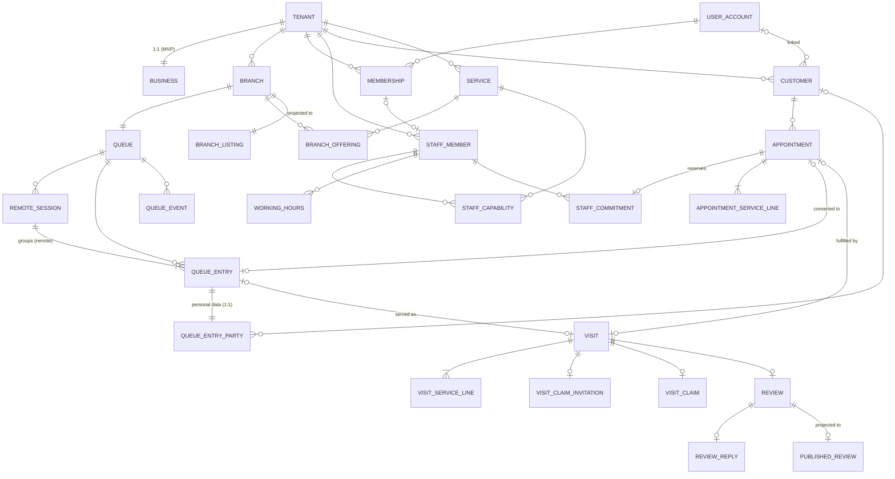

# Database Design — Barber MVP (PostgreSQL + PostGIS)

Version 0.3 · 2026-10-15 · Status: **Proposed (design only — no migrations)**. Implements the [domain model](../domain/domain-model.md). Security, roles, and RLS are covered in [tenant-isolation-and-security.md](tenant-isolation-and-security.md).

SQL fragments below are **illustrative** and pin down the intended constraints. They are not migrations.

> **Changelog v0.2** (audit round 2; see [05 §9](../05-design-review.md)):
> - Table classification registry (§3.0, B6-1).
> - `queue.remote_session` replaces the per-entry remote index (B1).
> - Visit claim invitations and claims (B2).
> - `discovery.published_review` projection replaces the definer view (B6-2).
> - Queue mutation protocol (§6.1, B4).
> - Branch lock and closure workflow (B5).
> - The `REQUEST_IN_PROGRESS` idempotency branch is replaced with the actual PostgreSQL behavior (§7).
> - Jobs need no RLS bypass (§8).
> - Maintenance role for partitions (§9, B6-3).
> - `PROVIDER` role code (N6).
> - One authoritative rollover setting (N5).
> - **v0.3 (focused security review, 2026-10-15; [05 §10](../05-design-review.md)):**
>   - `otp_challenge` stores no plaintext phone.
>   - Idempotency rows are keyed by user and surface (§7).
>   - Worked transaction example (§6.3).
>   - Delivery semantics separated: commit, persistence, delivery, receipt (§8.1).
>   - Party-row retention (§10).
> - Queue-entry personal data split into `queue.queue_entry_party`; `staff_live_status.expected_free_at`. Both serve B6-6: customer commands never read personal data or in-progress visits.

---

## 1. Conventions

| Topic | Convention | Why |
|---|---|---|
| Engine | PostgreSQL 16+ with `postgis`, `btree_gist`, `pg_trgm`, `citext` | Exclusion constraints, geo, fuzzy name search |
| Schemas | One per module: `identity`, `tenancy`, `catalog`, `scheduling`, `booking`, `queue`, `visit`, `crm`, `review`, `notification`, `discovery`, `platform` | Ownership is visible in the DB. Cross-module FKs are allowed **for integrity only**; code still goes through module facades. Each cross-schema FK is an extraction cost and is listed in §12. |
| Classification | Every table is listed in the **classification registry** (§3.0). Security treatment follows the class, **never** the presence of a `tenant_id` column. | B6-1 |
| Primary keys | `id uuid`, **UUIDv7 generated in the application** | Time-ordered (index-friendly), globally unique (tenant relocation, ADR-0002), not enumerable |
| Tenant ownership | Every `TENANT_OWNED` table has `tenant_id uuid NOT NULL` and `UNIQUE (tenant_id, id)`. Child FKs are **composite** `(tenant_id, parent_id)`. | A row can never reference another tenant's row (I-1), even if the app has a bug |
| Enumerations | `text` + `CHECK (col IN (...))` | Easier to evolve than PG enums |
| Time | `timestamptz` for instants; `tstzrange` `[)` for periods; branch-local recurring times as `smallint` minutes plus a branch `timezone` (IANA) | Correct across DST (Egypt observes DST) and midnight-crossing hours |
| Money | `bigint` minor units + `currency char(3)` on every money-bearing row | No float errors; snapshots are self-describing |
| Concurrency | `version integer NOT NULL DEFAULT 0` on mutable aggregates (appointment, queue entry, remote session, visit, review) | Conditional updates |
| Audit columns | `created_at`, `updated_at`; actor ids where meaningful | — |
| Deletion | Business entities are never hard-deleted (archive/status). Personal data is **anonymized** in place on erasure. Ephemeral tables are hard-deleted by retention jobs. | Snapshots and history stay valid |
| Text | Display names `text` with length CHECKs. Arabic search uses normalized columns (alef/yaa/taa-marbuta folding, diacritics stripped) indexed with `pg_trgm` | Arabic search quality |

## 2. Entity-relationship overview



## 3. Table catalogue

Abbreviations: **PK** primary key · **FK** foreign key · **UQ** unique · **CK** check · **IX** index.

### 3.0 Classification registry (B6-1)

The registry is a versioned file in the repository (e.g., `db/table-classification.yaml`, created with the first migration), mirrored by this table. CI compares it with the live catalog ([security §10](tenant-isolation-and-security.md)).

| Class | Meaning | Required controls | Tables |
|---|---|---|---|
| `TENANT_OWNED` | Operational data owned by one tenant | `tenant_id NOT NULL`; `UNIQUE (tenant_id, id)`; composite child FKs; RLS **enabled + forced**; standard tenant policy `TO turnio_app_staff, turnio_worker`; any customer policies `TO turnio_app_customer`; admin-grant policy `TO turnio_admin` | `tenancy.business`, `branch`, `membership`, `membership_branch_scope`, `invitation`, `staff_member`, `staff_branch_assignment`; `catalog.service`, `branch_offering`, `staff_capability`; all `scheduling.*`; all `booking.*`; all `queue.*`; all `visit.*`; all `crm.*`; `review.review`, `review_reply`, `rating_aggregate` |
| `TENANT_ROOT` | The tenant row itself | RLS: staff see their own tenant (`id = app.tenant_id()`); admin policies | `tenancy.tenant` |
| `PLATFORM_PERSONAL` | Platform-owned personal data, possibly referencing a tenant | RLS enabled + forced, with **own-subject** policies per role (security §5.6–5.7). The `tenant_id` column (if any) is a reference, not an ownership marker. | `identity.user_account`, `user_phone`, `user_email`, `auth_session`, `push_device`, `otp_challenge`; `notification.notification`, `notification_preference` |
| `PLATFORM_PRIVATE` | Platform operational data, no end-user reads | RLS enabled + forced; access only by named roles (worker, admin, maintenance) | `platform.outbox_event`, `consumer_checkpoint`, `idempotency_record`, `audit_event`, `admin_access_grant`; `identity.platform_role_grant`; `review.content_report`; pg-boss job tables |
| `PUBLIC_PROJECTION` | PII-free copies for anonymous reads | No RLS. Column allowlist test; written only by `turnio_worker`; `SELECT` granted to `turnio_public` | `discovery.branch_listing`, `discovery.published_review` |
| `REFERENCE` | Platform reference data | No RLS; read-only to runtime roles | `catalog.business_category`, `catalog.service_type`, `discovery.area` |

**Rule:** a table that isn't in the registry fails CI. Moving a table between classes needs a security review.

### 3.1 `identity` (PLATFORM_PERSONAL unless noted)

| Table | Key columns | Constraints & indexes |
|---|---|---|
| `user_account` | id, status, display_name, public_display_name, locale (`ar`/`en`), created_at, anonymized_at | CK status ∈ {ACTIVE, SUSPENDED, DELETION_REQUESTED, ANONYMIZED}; CK `char_length(public_display_name) BETWEEN 1 AND 40` |
| `user_phone` | id, user_id FK, phone_e164, phone_hash, verified_at, is_current, released_at | **UQ (phone_e164) WHERE is_current** (one current owner per phone); CK `phone_e164 ~ '^\+[1-9][0-9]{7,14}$'`. `phone_hash` = keyed HMAC (pepper in the secret store), used for login lookup and claim matching without exposing numbers. `turnio_auth` has column grants on `(id, user_id, phone_hash, is_current, verified_at)` only: no plaintext read ([security §5.7](tenant-isolation-and-security.md)). |
| `user_email` | user_id FK, email citext, verified_at | UQ (email) WHERE verified_at IS NOT NULL |
| `otp_challenge` | id, **phone_hash** (no plaintext), phone_hash_key_version, code_hash, purpose, status (ISSUED/VERIFIED/LOCKED/EXPIRED), attempts, expires_at, verified_at, consumed_at | IX (phone_hash, created_at); **UQ (phone_hash) WHERE status = 'ISSUED'** (one live challenge per phone). CK attempts BETWEEN 0 AND 5. Concurrency and key rotation: [security §5.7](tenant-isolation-and-security.md). Retention 24 h. Rate limits are enforced outside the DB. Access is limited to one phone hash per transaction ([security §5.7](tenant-isolation-and-security.md)). |
| `auth_session` | id, user_id, refresh_token_hash, family_id, expires_at, revoked_at, device_label | UQ (refresh_token_hash); IX (user_id). Rotation with family revocation on reuse. |
| `platform_role_grant` *(PLATFORM_PRIVATE)* | user_id, role, granted_by, granted_at, revoked_at | UQ (user_id, role) WHERE revoked_at IS NULL; CK role ∈ {ADMIN, MODERATOR, SUPPORT} |
| `push_device` | id, user_id, platform, token, last_seen_at | UQ (token) |

### 3.2 `tenancy`

| Table | Key columns | Constraints & indexes |
|---|---|---|
| `tenant` *(TENANT_ROOT)* | id, status, country_code `EG`, currency `EGP`, default_locale, plan_code, created_at | CK status ∈ {PENDING_VERIFICATION, ACTIVE, SUSPENDED, CLOSED} |
| `business` | id, tenant_id, category_code FK→catalog.business_category, slug, name_ar, name_en, legal_name, registered_address_text, verification_status, per_staff_pricing_enabled bool, tax_inclusive bool, tax_rate_bp int | **UQ (tenant_id)** (1:1, droppable, D-5b); UQ (slug); CK verification_status ∈ {DRAFT, SUBMITTED, VERIFIED, CHANGES_REQUESTED, REJECTED}; CK tax_rate_bp BETWEEN 0 AND 10000 |
| `branch` | id, tenant_id, business_id, slug, name_ar/en, status, governorate, city, area, street_text, landmark_text, **location geography(Point,4326)**, location_verified_at, timezone, **day_rollover_minute smallint** (the single authoritative rollover setting, D-22), phone_e164, version | FK (tenant_id, business_id); UQ (business_id, slug); **IX GiST (location)**; CK day_rollover_minute BETWEEN 0 AND 480; CK status ∈ {DRAFT, ACTIVE, TEMPORARILY_CLOSED, CLOSED}; CK `status <> 'ACTIVE' OR location IS NOT NULL`. The row is the lock target for closures and bookings (§6). |
| `membership` | id, tenant_id, user_id FK→identity.user_account, role, status, invited_by, joined_at | **UQ (tenant_id, user_id) WHERE status <> 'REMOVED'**; IX (user_id) (find my tenants); CK role ∈ {OWNER, MANAGER, FRONT_DESK, PROVIDER} (`PROVIDER` is labeled "Barber" in the UI for the barber category; N6) |
| `membership_branch_scope` | tenant_id, membership_id, branch_id | PK (membership_id, branch_id). Empty set = all branches (for Owner/Manager). Governs **permissions**; `staff_branch_assignment` governs **bookability**. A PROVIDER's scope must include its assigned branches (application check). |
| `invitation` | id, tenant_id, phone_e164 or email, role, token_hash, expires_at, status | UQ (token_hash); IX (tenant_id, status) |
| `staff_member` | id, tenant_id, membership_id NULL, display_name, bio, avatar_object_key, status, version | FK (tenant_id, membership_id); **UQ (membership_id) WHERE membership_id IS NOT NULL**; CK status ∈ {ACTIVE, INACTIVE, DEPARTED}. If the linked membership is REMOVED, the application requires the staff member to become INACTIVE or DEPARTED in the same transaction. |
| `staff_branch_assignment` | tenant_id, staff_member_id, branch_id, active | PK (staff_member_id, branch_id); FKs composite |

### 3.3 `catalog`

| Table | Key columns | Constraints & indexes |
|---|---|---|
| `business_category` *(REFERENCE)* | code (`barber`), name_ar/en, provider_label_ar/en, policy_set | PK code |
| `service_type` *(REFERENCE)* | code (`HAIRCUT`, `BEARD`, `KIDS_HAIRCUT`…), category_code, names | PK code |
| `service` | id, tenant_id, service_type_code NULL, name_ar/en, description, default_duration_min, base_price_minor, currency, status | CK duration BETWEEN 5 AND 480; CK base_price_minor >= 0; CK status ∈ {ACTIVE, ARCHIVED}; IX (tenant_id, status) |
| `branch_offering` | tenant_id, branch_id, service_id, active, price_override_minor NULL, duration_override_min NULL, online_bookable, queueable | PK (branch_id, service_id); FKs composite; CKs on override bounds |
| `staff_capability` | tenant_id, staff_member_id, service_id, active, price_override_minor NULL, duration_override_min NULL | PK (staff_member_id, service_id); FKs composite. Overrides are honored only if `business.per_staff_pricing_enabled` (application rule, tested). |

### 3.4 `scheduling`

| Table | Key columns | Constraints & indexes |
|---|---|---|
| `opening_hours` | tenant_id, branch_id, iso_weekday, start_minute, duration_min | CK iso_weekday BETWEEN 1 AND 7; CK start_minute BETWEEN 0 AND 1439; CK duration_min BETWEEN 1 AND 1440. Overlap checks per day, and **intervals must not span the branch rollover**, both validated in the application. |
| `working_hours` | tenant_id, staff_member_id, branch_id, iso_weekday, start_minute, duration_min, effective_from date, effective_to date NULL | Same CKs; CK effective_to IS NULL OR effective_to >= effective_from; IX (staff_member_id, branch_id) |
| `schedule_exception` | id, tenant_id, kind, branch_id NULL, staff_member_id NULL, period tstzrange, reason, special_hours jsonb NULL (validated schema), created_by_membership_id | CK kind ∈ {BRANCH_CLOSED, BRANCH_SPECIAL_HOURS, STAFF_TIME_OFF}; CK `(kind = 'STAFF_TIME_OFF') = (staff_member_id IS NOT NULL)`; IX GiST (branch_id, period). Branch closures and hour reductions follow [booking-lifecycle §5a](../domain/booking-lifecycle.md). |
| `staff_live_status` | tenant_id, staff_member_id, branch_id, status, expected_back_at, in_service_visit_id NULL, expected_free_at NULL, updated_at, version | PK (staff_member_id); CK status ∈ {AVAILABLE, ON_BREAK, UNAVAILABLE, OFF_SHIFT}. `in_service_visit_id` and `expected_free_at` are maintained by visit start, complete, and void under the queue mutation protocol (§6.1), so ETA reads never need visit rows. |
| **`staff_commitment`** | id, tenant_id, **resource_id** (= staff_member_id in the MVP), kind, appointment_id NULL, schedule_exception_id NULL, period tstzrange, active | see §5.1 |

### 3.5 `booking`

| Table | Key columns | Constraints & indexes |
|---|---|---|
| `branch_booking_policy` | tenant_id, branch_id PK, slot_granularity_min, min_notice_min, horizon_days, buffer_after_min, cancel_free_until_min_before, start_grace_min, max_reschedules, online_booking_enabled | CK bounds from [booking-lifecycle §3](../domain/booking-lifecycle.md) |
| `appointment` | id, tenant_id, branch_id, staff_member_id, customer_id, **customer_user_id NULL** (denormalized; set only when the customer is linked at creation, D-25), booked_by_user_id NULL, booked_by_membership_id NULL, attendee_label NULL, group_id NULL, requested_staff_mode (SPECIFIC/ANY), period tstzrange, status, source, total_price_minor, currency, tax_inclusive, tax_rate_bp, policy_snapshot jsonb, late_cancellation bool, cancel_reason, cancelled_by (CUSTOMER/BUSINESS/SYSTEM), closure_exception_id NULL, reschedule_count, checked_in_at, version, created_at | CK status ∈ {REQUESTED, CONFIRMED, CHECKED_IN, FULFILLED, CANCELLED, NO_SHOW, CONVERTED_TO_WALK_IN, REJECTED, EXPIRED}; CK `NOT isempty(period)`; CK total_price_minor >= 0; CK `num_nonnulls(booked_by_user_id, booked_by_membership_id) = 1`; IX (tenant_id, branch_id, lower(period)); IX (tenant_id, staff_member_id, lower(period)); IX (customer_user_id, lower(period) DESC) WHERE customer_user_id IS NOT NULL; IX (tenant_id, customer_id); IX (group_id) WHERE group_id IS NOT NULL |
| `appointment_service_line` | tenant_id, appointment_id, line_no, service_id, name_snapshot_ar/en, duration_min, price_minor | PK (appointment_id, line_no); CK duration > 0, price >= 0 |

### 3.6 `queue`

| Table | Key columns | Constraints & indexes |
|---|---|---|
| `queue` | id, tenant_id, branch_id, intake_status, **seq bigint**, current_business_day date, next_ticket_number int, policy columns ([queue-lifecycle §1](../domain/queue-lifecycle.md); no rollover column) | **UQ (branch_id)** (D-2, deliberate MVP limitation); UQ (tenant_id, id); CK intake_status ∈ {OPEN, PAUSED, CLOSED}; policy CKs |
| **`remote_session`** | id, tenant_id, queue_id, customer_id, customer_user_id, status, ended_reason, created_at, ended_at, version | see §5.2 |
| `queue_entry` *(no personal columns)* | id, tenant_id, queue_id, branch_id, business_day, ticket_number, source, state, presence, **remote_session_id NULL**, distance_check_passed NULL, group_id, preferred_staff_id NULL, assigned_staff_id NULL, origin_appointment_id NULL, sort_key numeric, skip_count, recall_count, arrive_by, arrived_at, **arrival_confirmed_by**, **arrival_confirmed_by_id**, called_at, ended_at, end_reason, price_min_minor, price_max_minor, currency, last_notified_eta_at, version, created_at | see §5.2 |
| **`queue_entry_party`** *(personal data)* | entry_id PK/FK, tenant_id, customer_id NULL, **customer_user_id NULL** (the organizer's account for every person in a remote session), display_name, attendee_label, anonymized_at NULL | FK (tenant_id, entry_id) → queue_entry; FK (tenant_id, customer_id) → crm.customer; CK `char_length(display_name) BETWEEN 1 AND 60`; IX (customer_user_id, entry_id) WHERE customer_user_id IS NOT NULL. Inserted in the same transaction as its entry; a nightly integrity job reports entries without a party row. Remote entries must have `customer_id` (application rule + test, because it is a cross-table rule). No runtime role has DELETE; retention anonymizes in place. Per-role access: [security §5.3a](tenant-isolation-and-security.md). |
| `queue_entry_service_line` | tenant_id, entry_id, line_no, service_id, name_snapshot | PK (entry_id, line_no) |
| `queue_event` | tenant_id, queue_id, **seq, idx**, occurred_at, type, entry_id NULL, appointment_id NULL, visit_id NULL, actor_type, actor_id NULL, payload jsonb (ids and states, **no PII**) | PK (queue_id, seq, idx, occurred_at); **partitioned by month on occurred_at**; IX (tenant_id, occurred_at). `seq` comes from the queue row increment (§6.1), so uniqueness across partitions follows from the lock. |

> **Note — no phone on queue entry:** a phone given for a walk-in always creates or reuses a Customer row (D-6, domain-model §5). So the entry stores no phone; notifications read it from the Customer.

### 3.7 `visit`

| Table | Key columns | Constraints & indexes |
|---|---|---|
| `visit` | id, tenant_id, branch_id, staff_member_id, customer_id NULL, customer_user_id NULL, display_name, attendee_label, appointment_id NULL, queue_entry_id NULL, status, started_at, completed_at, snapshot_total_minor, amount_charged_minor NULL, payment_method NULL, currency, tax_inclusive, tax_rate_bp, review_eligible_until NULL, version | see §5.3 |
| `visit_service_line` | tenant_id, visit_id, line_no, service_id, staff_member_id, name_snapshot, duration_min_snapshot, price_minor_snapshot | PK (visit_id, line_no); IX (tenant_id, staff_member_id, service_id) (for ETA medians, joined to `visit.completed_at`) |
| `visit_correction` | id, tenant_id, visit_id, field, old_value, new_value, reason, corrected_by, corrected_at | Append-only. CK field ∈ {amount_charged_minor, payment_method, service_lines} (no personal fields). The 48 h window is enforced in the application and checked in tests. |
| **`visit_claim_invitation`** | id, tenant_id, visit_id, token_hash, destination_phone_hash, channel, status, expires_at, issued_at, claimed_at, revoked_by NULL | see §5.3 |
| **`visit_claim`** | tenant_id, visit_id, user_id, claimed_at, method (`INVITATION`) | see §5.3 |

### 3.8 `crm`

| Table | Key columns | Constraints & indexes |
|---|---|---|
| `customer` | id, tenant_id, user_id NULL, linked_at NULL, display_name, phone_e164 NULL, phone_hash NULL, acquisition_source, first_seen_at, no_show_count, remote_cooldown_until (scope open, D-35), blocked_at, status, anonymized_at | **UQ (tenant_id, user_id) WHERE user_id IS NOT NULL**; **UQ (tenant_id, phone_e164) WHERE phone_e164 IS NOT NULL AND status = 'ACTIVE'**; CK `(user_id IS NULL) = (linked_at IS NULL)`; CK acquisition_source ∈ {MARKETPLACE_SEARCH, BUSINESS_LINK, STAFF_ENTRY, IMPORT, OTHER}; IX (user_id); IX (tenant_id, phone_hash) |
| `guardian_consent` | id, tenant_id, customer_id, attendee_label, consent_text_version, given_at, given_via | Append-only (D-24, pending legal) |

### 3.9 `review`

| Table | Key columns | Constraints & indexes |
|---|---|---|
| `review` | id, tenant_id, branch_id, staff_member_id, visit_id, author_user_id, rating, body, public_display_name, visit_month date, status, published_at, edited_at, edit_deadline, version | **UQ (visit_id)**; CK rating BETWEEN 1 AND 5; CK char_length(body) <= 2000; CK status ∈ {SUBMITTED, PUBLISHED, REJECTED_AUTOMATED, HIDDEN, REMOVED, WITHDRAWN}; IX (branch_id, published_at DESC) WHERE status='PUBLISHED'; IX (staff_member_id, published_at DESC) WHERE status='PUBLISHED'; IX (author_user_id) |
| `review_reply` | tenant_id, review_id PK, author_membership_id, body, status, created_at | CK char_length(body) <= 1000 |
| `content_report` *(PLATFORM_PRIVATE)* | id, target_type, target_id, tenant_id, reporter_user_id NULL, reason, details, status, resolved_by, resolved_at | IX (status, created_at) |
| `rating_aggregate` | tenant_id, subject_type (BRANCH/STAFF), subject_id, count, sum, dist_1..dist_5, updated_at | PK (subject_type, subject_id); maintained transactionally on review publish/hide/remove/edit. Public average shown only if count ≥ 3. |

### 3.10 `notification` (PLATFORM_PERSONAL)

| Table | Key columns | Constraints & indexes |
|---|---|---|
| `notification` | id, tenant_id NULL (reference), recipient_user_id NULL, recipient_customer_id NULL, channel, template_key, locale, payload jsonb, dedupe_key, status, attempts, next_attempt_at, provider_message_id, created_at | **UQ (dedupe_key)**; CK `num_nonnulls(recipient_user_id, recipient_customer_id) = 1`; CK `recipient_customer_id IS NULL OR tenant_id IS NOT NULL`; IX (status, next_attempt_at) WHERE status IN ('PENDING','RETRY'); IX (recipient_user_id, created_at DESC). **Payload rule:** ids, business/branch names, ticket numbers, times, and the recipient's *own* display name only. Never phone numbers or other customers' data. |
| `notification_preference` | user_id, channel, category, enabled, quiet_hours | PK (user_id, channel, category) |

### 3.11 `discovery` (PUBLIC_PROJECTION, no PII)

| Table | Key columns | Indexes |
|---|---|---|
| `branch_listing` | branch_id PK, tenant_id (reference), business_slug, branch_slug, names, normalized_search_text, area, governorate, **location geography**, service_type_codes text[], price_min/max_minor, currency, rating_avg NULL (if count < 3), rating_count, opening_hours_summary jsonb, timezone, accepts_walk_ins, remote_join_enabled, live_status, wait_bucket (`<15`, `15-30`, `30-60`, `60+`), next_slot_at, is_listed, updated_at | **GiST (location) WHERE is_listed**; GIN (service_type_codes); GIN trgm (normalized_search_text); IX (area) |
| **`published_review`** | review_id PK, branch_id, staff_member_id, rating, body, public_display_name, visit_month, reply_body NULL, published_at | IX (branch_id, published_at DESC); IX (staff_member_id, published_at DESC) |
| `area` *(REFERENCE)* | id, governorate, name_ar/en, centroid geography | GiST (centroid) |

- The worker updates projections from domain events. Live fields are refreshed at most every 30 s per branch.
- A review leaves `published_review` in the same consumer run that processes its HIDDEN/REMOVED/WITHDRAWN event. Lag is bounded by relay latency, with a target of p95 < 10 s.
- A CI **column allowlist test** fails if a projection gains a column that isn't on the approved list.

### 3.12 `platform` (PLATFORM_PRIVATE)

| Table | Key columns | Notes |
|---|---|---|
| `outbox_event` | id (uuidv7), tenant_id NULL, aggregate_type, aggregate_id, type, payload jsonb (**ids and states only, no PII**), occurred_at, published_at NULL | IX (id) WHERE published_at IS NULL |
| `consumer_checkpoint` | consumer, event_id | PK (consumer, event_id). Consumer idempotency. |
| `idempotency_record` | **user_id**, **surface** (`customer` / `staff:<tenant_id>` / `admin`), key, request_hash, response_status, response_body jsonb, created_at, expires_at | PK (user_id, surface, key); RLS: runtime roles see and update **only rows where `user_id = app.user_id()`**; retention 48 h. See §7. |
| `audit_event` | id, occurred_at, tenant_id NULL, actor_type (USER, STAFF, ADMIN, SYSTEM, MAINTENANCE), actor_user_id, actor_platform_role NULL, admin_access_grant_id NULL, action, target_type, target_id, reason, request_id, ip_hash, changes jsonb (no raw PII) | Partitioned by month; append-only (§9) |
| `admin_access_grant` | id, admin_user_id, tenant_id, scope (READ/WRITE), reason, ticket_ref, granted_at, expires_at, revoked_at | CK expires_at <= granted_at + interval '8 hours' |

## 4. Geospatial design

- `branch.location` and `branch_listing.location` use `geography(Point, 4326)` with GiST indexes.
- **Radius search:** `WHERE is_listed AND ST_DWithin(location, :point, :radius_m) ORDER BY location <-> :point LIMIT :n`. The KNN `<->` operator on geography is index-assisted in current PostGIS.
- **Cursor pagination** by `(distance, branch_id)`. The cursor encodes the last distance and id. Offset pagination is not used.
- **Manual location:** an area picker resolves to the area centroid (`discovery.area`, seeded for the launch city) or a geocoded point. Search requires neither device permission nor storing the point.
- **Location verification (D-13):** the owner drags a pin, and an admin compares it with the geocoded address and photos. If a verified pin moves more than 200 m, the business returns to SUBMITTED.
- **Privacy:** the user's search point exists only in the request. The remote-join distance check computes `ST_DWithin` and stores only `distance_check_passed boolean` on the entry, never the coordinates.

## 5. Integrity constraints for the core invariants

### 5.1 Staff commitments (I-2 no double booking)

```sql
-- illustrative
CREATE TABLE scheduling.staff_commitment (
  id            uuid PRIMARY KEY,
  tenant_id     uuid NOT NULL,
  resource_id   uuid NOT NULL,             -- staff_member_id in the MVP (RD-4)
  kind          text NOT NULL CHECK (kind IN ('APPOINTMENT','TIME_OFF')),
  appointment_id        uuid,
  schedule_exception_id uuid,
  period        tstzrange NOT NULL CHECK (NOT isempty(period) AND lower_inc(period) AND NOT upper_inc(period)),
  active        boolean NOT NULL DEFAULT true,
  CHECK ((kind = 'APPOINTMENT') = (appointment_id IS NOT NULL)),
  CHECK ((kind = 'TIME_OFF')    = (schedule_exception_id IS NOT NULL)),
  FOREIGN KEY (tenant_id, resource_id)    REFERENCES tenancy.staff_member (tenant_id, id),
  FOREIGN KEY (tenant_id, appointment_id) REFERENCES booking.appointment (tenant_id, id),
  EXCLUDE USING gist (resource_id WITH =, period WITH &&) WHERE (active)
);
CREATE UNIQUE INDEX ON scheduling.staff_commitment (appointment_id) WHERE active AND appointment_id IS NOT NULL;
```

- `period` = `[start, end + buffer_after)`.
- Releasing a commitment sets `active = false`. It is never deleted, so history keeps the plan.
- Actual service overruns are *not* commitments (C-3).
- **Branch closures are not commitments.** A provider may work at another branch during one branch's closure. Closure safety comes from the branch lock and the resolution workflow ([booking-lifecycle §5a](../domain/booking-lifecycle.md)), plus a daily integrity job.

### 5.2 Remote sessions and queue entries (I-4, I-11, P-1, ordering)

```sql
-- illustrative
-- Remote session: product rule P-1 (provisional D-3), enforced race-free by a partial unique index.
CREATE TABLE queue.remote_session (
  id uuid PRIMARY KEY, tenant_id uuid NOT NULL, queue_id uuid NOT NULL,
  customer_id uuid NOT NULL, customer_user_id uuid NOT NULL,
  status text NOT NULL CHECK (status IN ('ACTIVE','ENDED')),
  ended_reason text CHECK (ended_reason IN ('ALL_ENTRIES_ENDED','CANCELLED_BY_CUSTOMER','CANCELLED_BY_STAFF','EXPIRED','END_OF_DAY')),
  ended_at timestamptz, version int NOT NULL DEFAULT 0,
  CHECK ((status = 'ENDED') = (ended_at IS NOT NULL AND ended_reason IS NOT NULL)),
  UNIQUE (tenant_id, queue_id, id),
  FOREIGN KEY (tenant_id, queue_id)    REFERENCES queue.queue (tenant_id, id),
  FOREIGN KEY (tenant_id, customer_id) REFERENCES crm.customer (tenant_id, id)
);
-- P-1: one ACTIVE remote session per user, platform-wide (below RLS; see security §6).
-- Changing the policy (e.g. per branch) = replace this index; nothing else changes.
CREATE UNIQUE INDEX remote_session_one_active_per_user
  ON queue.remote_session (customer_user_id) WHERE status = 'ACTIVE';

-- Queue entry
CHECK (state IN ('WAITING','CALLED','SERVED','CANCELLED','NO_SHOW','EXPIRED'))
CHECK (presence IN ('NOT_ARRIVED','ARRIVED'))
CHECK ((presence = 'ARRIVED') = (arrived_at IS NOT NULL AND arrival_confirmed_by IS NOT NULL))
CHECK (arrival_confirmed_by IS NULL OR arrival_confirmed_by IN ('STAFF','CUSTOMER_SELF','KIOSK'))
CHECK (state <> 'CALLED' OR (assigned_staff_id IS NOT NULL AND called_at IS NOT NULL AND presence = 'ARRIVED'))
CHECK (source IN ('STAFF_WALK_IN','STAFF_DIRECT','CONVERTED_APPOINTMENT','REMOTE_APP','REMOTE_WEB','KIOSK'))
CHECK ((source IN ('REMOTE_APP','REMOTE_WEB')) = (remote_session_id IS NOT NULL))
CHECK (remote_session_id IS NULL OR (group_id = remote_session_id AND arrive_by IS NOT NULL))
CHECK ((source = 'CONVERTED_APPOINTMENT') = (origin_appointment_id IS NOT NULL))
CHECK (state <> 'NO_SHOW' OR presence = 'ARRIVED')          -- late remote customers EXPIRE, never NO_SHOW
CHECK ((state IN ('SERVED','CANCELLED','NO_SHOW','EXPIRED')) = (ended_at IS NOT NULL))
CHECK (skip_count BETWEEN 0 AND 3)
CHECK (price_min_minor <= price_max_minor)
FOREIGN KEY (tenant_id, queue_id, remote_session_id) REFERENCES queue.remote_session (tenant_id, queue_id, id)  -- I-11

UNIQUE (queue_id, business_day, ticket_number)
-- I-4: one CALLED entry per provider
CREATE UNIQUE INDEX ON queue.queue_entry (assigned_staff_id) WHERE state = 'CALLED';
-- one queue entry per converted appointment
CREATE UNIQUE INDEX ON queue.queue_entry (origin_appointment_id) WHERE origin_appointment_id IS NOT NULL;
-- hot paths
CREATE INDEX ON queue.queue_entry (queue_id, business_day, sort_key) WHERE state IN ('WAITING','CALLED');
CREATE INDEX ON queue.queue_entry (remote_session_id) WHERE remote_session_id IS NOT NULL;
-- "my entries" lookups use queue_entry_party (customer_user_id)
```

- **Session release:** in the same transaction as any entry's terminal transition, run `UPDATE queue.remote_session SET status='ENDED', ended_reason=…, ended_at=now() WHERE id=$s AND status='ACTIVE' AND NOT EXISTS (SELECT 1 FROM queue.queue_entry WHERE remote_session_id=$s AND state IN ('WAITING','CALLED'))`. The queue lock (§6.1) serializes this with any concurrent "add person".
- The old per-entry index "one active remote entry per user" is **withdrawn**. It rejected groups (audit B1).

### 5.3 Visits, claims, and invitations (I-3, I-6, I-12)

```sql
-- illustrative
CHECK (num_nonnulls(appointment_id, queue_entry_id) = 1)
CHECK (status IN ('IN_SERVICE','COMPLETED','VOIDED'))
CHECK (status <> 'COMPLETED' OR (completed_at IS NOT NULL AND amount_charged_minor IS NOT NULL AND payment_method IS NOT NULL))
CHECK (completed_at IS NULL OR completed_at >= started_at)
CHECK (amount_charged_minor IS NULL OR amount_charged_minor >= 0)
FOREIGN KEY (tenant_id, appointment_id) REFERENCES booking.appointment (tenant_id, id)
FOREIGN KEY (tenant_id, queue_entry_id) REFERENCES queue.queue_entry (tenant_id, id)
CREATE UNIQUE INDEX ON visit.visit (appointment_id) WHERE appointment_id IS NOT NULL;
CREATE UNIQUE INDEX ON visit.visit (queue_entry_id) WHERE queue_entry_id IS NOT NULL;
CREATE UNIQUE INDEX ON visit.visit (staff_member_id) WHERE status = 'IN_SERVICE';   -- D-28
CREATE INDEX ON visit.visit (tenant_id, branch_id, started_at DESC);
CREATE INDEX ON visit.visit (customer_user_id, started_at DESC) WHERE customer_user_id IS NOT NULL;

-- Claim invitation (one per visit, single use)
CHECK (status IN ('ISSUED','CLAIMED','EXPIRED','REVOKED'))
CHECK ((status = 'CLAIMED') = (claimed_at IS NOT NULL))
UNIQUE (visit_id)
UNIQUE (token_hash)
FOREIGN KEY (tenant_id, visit_id) REFERENCES visit.visit (tenant_id, id)

-- Claim (visit ownership for exactly one visit)
PRIMARY KEY (visit_id)                         -- duplicate claims impossible
FOREIGN KEY (tenant_id, visit_id) REFERENCES visit.visit (tenant_id, id)
CREATE INDEX ON visit.visit_claim (user_id, claimed_at DESC);
```

**Claim transaction** (runs as `turnio_app_customer`, `ctx = customer_command`):
- The claim link carries an opaque tenant id plus the token. The tenant id sets `app.tenant_id`, so token lookup never scans other tenants.
1. `UPDATE visit_claim_invitation SET status='CLAIMED', claimed_at=now() WHERE token_hash=$h AND status='ISSUED' AND expires_at > now() RETURNING visit_id`. The RLS policy additionally restricts the row to `destination_phone_hash = app.verified_phone_hash()`. Zero rows → `404 INVITATION_INVALID`, a generic answer that doesn't reveal which check failed.
2. `INSERT INTO visit_claim`. The PK guards against duplicates.
3. Audit event.
- No visit read is needed beforehand. Invitations are issued only for COMPLETED visits, and a COMPLETED visit cannot change state (corrections don't change status). After the claim row exists, the visit becomes visible through the ownership policy.

Issuing an invitation is skipped when `visit.customer_user_id` is already set (the visit is already owned) or when the customer has no phone.

**Data integrity notes:**
- The CHECK + unique indexes guarantee *exactly one source, at most one visit per source*.
- The **source state** (FULFILLED/SERVED) is kept consistent by the start transaction, not by the database.
- No constraint forces a FULFILLED appointment or a SERVED entry to have a visit. A nightly integrity job reports orphans in both directions.
- A VOIDED visit permanently consumes its source (by design: history stays append-only).

### 5.4 Snapshot immutability (I-9)

- `turnio_app_staff` and `turnio_worker` are granted `UPDATE` only on the mutable columns of `appointment`, `visit`, and their lines, using **column-level privileges**. `turnio_app_customer` has no UPDATE on these columns. Snapshot columns are not updatable by any runtime role.
- Corrections go to `visit_correction`.

## 6. Transaction boundaries and locking

**Isolation:** `READ COMMITTED`, combined with explicit row locks, conditional updates, and constraints. `SERIALIZABLE` is not used by default. Snapshots for real-time recovery use `REPEATABLE READ, READ ONLY`.

**Lock order** (deadlock avoidance; every command follows it):
1. `tenancy.branch` row (closures and hour reductions take `FOR UPDATE`; bookings take `FOR SHARE`);
2. `queue.queue` row of the branch (every command in §6.1's scope);
3. `tenancy.staff_member` rows, in ascending id order;
4. aggregate rows: remote session → appointments → queue entries (ascending id) → visits;
5. `crm.customer`, `review.rating_aggregate`.

Every transaction sets `SET LOCAL lock_timeout = '2s'` and `statement_timeout = '5s'`.

### 6.1 Queue mutation protocol (B4)

**Applies to** every command that changes the state of a branch queue, its lanes, or its ETAs for the **current business day**. The authoritative list is [queue-lifecycle §7](../domain/queue-lifecycle.md). It includes:
- entry create/arrive/call/recall/skip/hand back/start/cancel/expire/reorder/transfer;
- remote session create/add/cancel;
- visit start/complete/void;
- staff live status changes;
- today's appointment changes;
- today's schedule changes and closures;
- intake and policy changes;
- rollover.

**Steps, all in one database transaction:**
1. `BEGIN`. Set the request context (security §4) and the timeouts.
2. If the command has an idempotency key: insert the `idempotency_record` (§7). On a stored replay, return the stored response and stop. Nothing below runs, so no `seq` is consumed.
3. If it is a branch-level command (closure, hours): lock the branch row `FOR UPDATE`.
4. **Lock and reserve the sequence in one statement:** `UPDATE queue.queue SET seq = seq + 1 WHERE id = $queue RETURNING seq, current_business_day, intake_status`. This takes the queue row lock and yields the transaction's single `seq`.
5. Lock staff rows (ascending id) if the command involves providers.
6. **Validate** guards against the locked state, then apply conditional updates `… WHERE id = $id AND state = $expected AND version = $v`. Any guard failure → `ROLLBACK` and return a 409 or 422 domain error. The `seq` increment rolls back with it, so there is **no gap**.
7. Write all authoritative changes: entries, sessions, visits, appointments, commitments, status.
8. Insert `queue_event` rows `(queue_id, seq, idx = 0..n-1)`, one per logical change, and **one** `outbox_event` that references `(queue_id, seq)`. Write audit rows where required.
9. `COMMIT`.

**Guarantees:**
- **Exactly one increment per committed command.** Multi-change commands (group cancel, rollover, closure) share one `seq`, with several `idx` values.
- **No events for rolled-back work.** Events live in rows that only exist after commit. The relay reads committed outbox rows only. `NOTIFY` is issued by the relay after commit; PostgreSQL delivers it only on commit anyway.
- **Gap-free per queue:** the increment and the events commit or roll back together.
- Commands that touch **two queues** don't exist in the MVP. A remote session is bound to one queue, and P-1 conflicts are detected by the unique index, not by locking another queue.

**Retries** (server side, whole transaction, at most 3 attempts with jittered backoff of 50–200 ms):
- **Retried:** `40P01` deadlock, `55P03` lock timeout, `40001` serialization failure, connection loss **before** commit.
- **Not retried:** domain 409/422 errors and constraint violations mapped to domain errors.
- **Connection lost during COMMIT** (outcome unknown): return `503` with `Retry-After`. The client retries with the same idempotency key, or re-reads state for version-guarded commands.

**Client recovery:** see [queue-lifecycle §9](../domain/queue-lifecycle.md). In short:
- apply batches in `seq` order;
- ignore duplicates;
- on a gap, wait briefly, then replay `afterSeq` or take a consistent snapshot (`REPEATABLE READ` read of state + `seq`).

### 6.2 Command table

| Command | Locks (in order) | Writes | Relies on |
|---|---|---|---|
| Create appointment (future business day) | branch `FOR SHARE`, staff `FOR SHARE` | appointment + lines, commitment, own customer row, idempotency record, outbox | Exclusion constraint; hours and closure check under the share locks |
| Create appointment / reschedule / cancel / check-in / no-show / convert / reassign (**today**) | branch `FOR SHARE` (create/reschedule), **queue protocol**, staff | as above + `queue_event`; convert also creates a queue entry | as above + `(status, version)` |
| Reschedule / cancel / no-show (future day) | branch `FOR SHARE` (reschedule), appointment conditional update | commitment deactivate/insert; outbox | Exclusion constraint |
| Change working hours / add time off | staff `FOR UPDATE` (+ queue protocol if today) | hours/exception rows; TIME_OFF commitment | Exclusion constraint; no active commitment outside the new hours |
| Branch closure / hours reduction | branch `FOR UPDATE` (+ queue protocol if today) | exception; per-appointment resolutions; audit; outbox | Recomputed affected set equals the submitted set ([booking-lifecycle §5a](../domain/booking-lifecycle.md)) |
| Join queue / add person to session | **queue protocol** (`seq` + `next_ticket_number` in the same UPDATE) | session (insert or lock), own customer row, entry + lines, events, outbox | Caps checked under the lock; P-1 unique index; I-11 FK |
| Arrive / call / recall / skip / hand back / cancel / reorder / transfer / expire | **queue protocol** | entry conditional update; session release check; events; audit for reorder/override | I-4; D-4 fit rule under the lock |
| Start visit (from entry or appointment) | **queue protocol**, staff `FOR UPDATE` | source → SERVED/FULFILLED; visit + lines (snapshot for this provider); session release check; events | I-3, I-6 |
| Complete / void visit | **queue protocol**, staff `FOR UPDATE` | visit conditional update; events; outbox (`visit.completed` → claim invitation, review invitation, analytics, ETA medians) | CKs |
| Visit correction | visit `FOR UPDATE` (no queue lock; lanes unaffected) | `visit_correction`; audit | 48 h window |
| Staff live status change | **queue protocol**, staff `FOR UPDATE` | status; CALLED entry handed back if becoming unavailable; events | — |
| Claim visit | invitation conditional update | invitation, `visit_claim`, audit | UQ visit_id; single use |
| Submit review | none beyond insert | review (SUBMITTED), outbox → automated check job → PUBLISHED + `rating_aggregate` (`FOR UPDATE`) + projection | UQ (visit_id); eligibility: COMPLETED ∧ unexpired ∧ caller owns the visit (`customer_user_id` or `visit_claim`) |
| Link customer to user | customer `FOR UPDATE` | customer.user_id, linked_at | UQ (tenant_id, user_id). History is **not** backfilled (D-25). |

**Why one lock per queue is acceptable:**
- A branch queue sees roughly ≤ 1 command per few seconds at peak (ASSUMPTION-11, to be measured in the pilot).
- The lock makes `seq` gap-free (I-8) and makes "check caps, then insert" safe without SERIALIZABLE.

### 6.3 Worked example: "complete visit" (v0.3)

Barber S taps **Complete** on visit V (from queue entry E in remote session R) and enters the amount charged and the payment method. The request carries V's expected `version`.

| # | Statement (one transaction, READ COMMITTED) | Effect |
|---|---|---|
| 0 | `BEGIN; SET LOCAL lock_timeout='2s', statement_timeout='5s'`; set context (`ctx=staff`, tenant, user) | — |
| 1 | `UPDATE queue.queue SET seq = seq + 1 WHERE id = $q RETURNING seq` | **Queue row locked**; `seq = N` allocated (uncommitted) |
| 2 | `SELECT … FROM tenancy.staff_member WHERE id = $S FOR UPDATE` | Staff row locked (lock order step 3) |
| 3 | `UPDATE visit.visit SET status='COMPLETED', completed_at=now(), amount_charged_minor=$a, payment_method=$m, review_eligible_until=now()+'14 days', version=version+1 WHERE id=$V AND status='IN_SERVICE' AND version=$v` | 0 rows → step 9a |
| 4 | `UPDATE scheduling.staff_live_status SET in_service_visit_id=NULL, expected_free_at=NULL, version=version+1 WHERE staff_member_id=$S` | Lane freed |
| 5 | (No entry/session change: E became SERVED and R was released, if it was R's last active entry, when the visit **started**.) | — |
| 6 | `INSERT INTO queue.queue_event (queue_id, seq, idx, …) VALUES ($q, N, 0, 'visit.completed', …), ($q, N, 1, 'lane.freed', …)` | Event batch N persisted (uncommitted) |
| 7 | `INSERT INTO platform.outbox_event (…, type='visit.completed', payload={visit_id, queue_id, seq:N})` | Outbox record persisted (uncommitted) |
| 8 | `COMMIT` | **Database commit**: visit, lane, events, and outbox become visible atomically |
| 9a | Any guard failure, constraint violation, or timeout → `ROLLBACK` | Nothing persists: no visit change, no `seq` N (the next command reuses N), no events, no outbox. 409/422 to the client; retried per §6.1 only for deadlock, lock timeout, or serialization failure. |

**After commit:**
- **Crash before the HTTP response:** the client times out and retries with version `v`. It gets `409 INVALID_STATE` with the current state (`COMPLETED` by S), which it treats as success (queue-lifecycle §9).
- **Crash before the relay ran:** the outbox row is durable. The relay processes it whenever it next runs (§8.1).
- Claim and review invitations, analytics, and ETA medians are produced by **consumers** of the outbox event, never inside this transaction.

## 7. Idempotency

- Every mutating customer or staff **creation** command accepts `Idempotency-Key`. It is required for create-appointment, join-queue, add-person, and claim.
- **Scope:** `(user_id, surface, key)`. `user_id` comes from the authenticated token, never from the request, and RLS restricts every read or write to `user_id = app.user_id()`. Another user presenting the same key gets no access to the stored response; their insert simply creates their own row.
- **`request_hash`** = SHA-256 over the canonical form of: HTTP method, route template, target tenant id and branch/resource ids, and the request body. The same key reused for a different tenant, branch, or payload → `422 IDEMPOTENCY_KEY_REUSED`. Replay across tenants or operations is therefore impossible.
- **Concurrency summary:**
  - two simultaneous requests with the same `(user, surface, key)`: the second insert **waits** on the first transaction's uncommitted row;
  - first commits → the second sees the conflict, reads the committed row, and replays its response (same hash) or returns 422;
  - first rolls back → the second proceeds as the only execution.
  At most one successful execution exists per key. For remote joins, the P-1 session index and caps are a second line of defense; for bookings, the exclusion constraint is.
- State transitions use the `(state, version)` precondition instead (queue-lifecycle §9).
- In the same transaction as the command, as its **first write**:
  1. `INSERT INTO platform.idempotency_record (scope, key, request_hash, …) ON CONFLICT DO NOTHING`.
  2. If a **concurrent** request with the same key is still in flight, PostgreSQL blocks this insert on the unique index until that transaction ends. There is therefore no "in progress" state to report:
     - the other transaction committed → read its row: same hash → return the stored response; different hash → `422 IDEMPOTENCY_KEY_REUSED`;
     - the other transaction rolled back → this insert proceeds and the command executes normally.
     The wait is bounded by `lock_timeout`; on timeout → `503` with `Retry-After`.
  3. On success, the response is stored in the same row before commit.
- **Domain rejections** (e.g., `409 SLOT_UNAVAILABLE`) roll back the whole transaction, including the idempotency row. A retry with the same key re-executes and may succeed if conditions changed. This is deliberate: only **successful** outcomes are replayed.

## 8. Outbox, events, and background jobs

- **Outbox:** written in the same transaction as the change. The relay (worker) reads unpublished rows with `FOR UPDATE SKIP LOCKED`, then:
  1. enqueues consumer jobs (pg-boss);
  2. issues `NOTIFY realtime, '<queue_id>:<seq>'`;
  3. sets `published_at`.
  All three happen in **one relay transaction** (§8.1). It provides at-least-once delivery. Consumers deduplicate via `consumer_checkpoint`.
- **Real-time gateway:**
  - `LISTEN` uses a **dedicated direct connection**, not a pooled one.
  - On notify, the gateway reads `queue_event` rows after the client's `lastSeq` under the subscriber's own authorization context and pushes them.
  - The gateway never trusts NOTIFY payload content beyond ids.
- **Scheduled work without RLS bypass** (replaces the v0.1 "RLS-exempt due views"):
  - **One-off timers** (arrival expiry, pre-expiry warning, appointment reminders, invitation expiry) are enqueued as pg-boss jobs with a `startAfter` time, **in the same transaction** as the domain change that creates them. The payload is `(tenant_id, object id)` only. Job tables are PLATFORM_PRIVATE and readable only by `turnio_worker`.
  - **Recurring per-branch work** (end-of-day rollover) is scheduled when a branch is activated or its rollover setting changes, as a self-rescheduling job per branch.
  - **Platform sweeps** (retention purges of PLATFORM_PRIVATE tables, discovery refresh) touch only platform tables.
  - **Every job** opens its own transaction and sets the context `(worker, tenant_id)` from the payload before touching tenant tables. A job that finds its object already in a terminal state does nothing (idempotent).
  - **Detective sweeps** (orphan visits, appointments inside closures) run per tenant, iterating `tenancy.tenant` ids, which the worker may read, and setting each tenant context in turn.
- **Maintenance jobs** (partition creation/retirement) are **not** worker jobs. See §9.

### 8.1 Delivery semantics (v0.3)

Four distinct stages. **No stage claims exactly-once external delivery.**

| Stage | What it means | Guarantee | Failure handling |
|---|---|---|---|
| **1. Database commit** | The command's state changes, `queue_event` batch, and outbox row commit together | Atomic. All or nothing. | A rollback leaves no trace (§6.3 9a) |
| **2. Event persistence** | `queue_event` (for real-time) and `outbox_event` (for consumers) exist durably | Durable once committed. `queue_event` is the replay source for clients. | Survives app crashes; covered by PITR |
| **3. Event delivery** (relay → consumers / gateway) | The relay transaction: `SELECT … FROM outbox_event WHERE published_at IS NULL ORDER BY id LIMIT n FOR UPDATE SKIP LOCKED` → insert pg-boss jobs → `NOTIFY realtime` → set `published_at` → **commit** | Enqueue and mark-published are **one transaction**, so outbox rows are never lost and never double-enqueued. *This atomicity holds only because pg-boss stores jobs in the same PostgreSQL database.* Redis is used only for rate limits, cache, and (at scale) best-effort real-time fan-out, never for jobs. Moving jobs to Redis or an external broker would lose this property: the relay would become at-least-once publication, and the design would need revisiting. `NOTIFY` is sent only on commit. **Job execution is at-least-once:** a handler may run again after a crash or timeout. | pg-boss retries with exponential backoff (e.g., 5 attempts), then moves the job to a dead-letter state with an alert. Handlers are idempotent: each records `consumer_checkpoint (consumer, event_id)` **in the same transaction** as its DB side effects, so a re-run that finds the checkpoint does nothing. **External side effects** (SMS/WhatsApp/push) are at-least-once. `notification.dedupe_key` prevents creating a second notification row. A crash after the provider accepted a message but before the status was recorded can still cause a **duplicate send**, unless the chosen provider supports idempotency keys (D-8, unknown). |
| **4. Client receipt** | The gateway, notified by `NOTIFY`, reads `queue_event` rows with `seq > lastSeq` for each subscribed queue under the subscriber's context and pushes them | **Best-effort push; correctness comes from `seq`.** A lost NOTIFY, dropped socket, or missed push is detected by the client. | Every 15 s the gateway sends `HEARTBEAT {seq}` with the queue's **current committed `seq`**, read from `queue.queue`, so a silent gap is detected even when no new events arrive. Clients ignore duplicates (`seq ≤ lastSeq`), apply the next batch, and replay or snapshot on a gap (queue-lifecycle §9). Missing NOTIFYs therefore delay updates by at most one heartbeat and never corrupt state. |

## 9. Audit requirements and maintenance

| Category | Examples | Where |
|---|---|---|
| Security | Login anomalies, OTP lockouts, session revocations, platform role grants, admin access grants and every request made under one | `audit_event` |
| Tenant administration | Membership invite/role change/removal, staff departure, policy changes, price changes, branch pin moves, closures with their resolutions | `audit_event` |
| Operational overrides | Queue reorder, D-4 fit-rule override, visit void/correction, manual no-show, block/unblock customer, invitation revocation | `audit_event` (+ `queue_event` for queue history) |
| Moderation | Review hide/restore/remove, business verification decisions, suspensions | `audit_event` |
| Privacy | Data export, erasure requests and execution, consent records, visit claims | `audit_event` + `guardian_consent` |
| Maintenance | Partition create/detach/drop, retention purges | `audit_event` (actor_type `MAINTENANCE`) |

- **Append-only:** runtime roles have `INSERT` only on `audit_event`. No `UPDATE`/`DELETE` grants.
- **Content:** identifiers, action, reason, and field names changed. No raw phone numbers or message bodies.
- **Same transaction** as the action it records, so an action cannot happen without its audit row.

**Maintenance role (B6-3):**
- `turnio_maint` is a LOGIN role and a member of the NOLOGIN ownership role `turnio_owner`, which partition DDL requires.
- It is used **only** by a separately deployed scheduled maintenance task with its own credentials. API, real-time, and worker deployments never receive these credentials.
- Allowed operations:
  - create next month's partitions for `queue_event` and `audit_event`;
  - detach and drop partitions older than retention;
  - `VACUUM`/`ANALYZE` if needed.
- Every operation writes an `audit_event` (`actor_type = MAINTENANCE`) and a job log.
- **Migrations** use a different role, `turnio_migrator` (also a member of `turnio_owner`), from CI/CD only.

## 10. Data retention (proposal — D-18, needs legal confirmation under PDPL)

| Data | Retention | Mechanism |
|---|---|---|
| User search location | Not stored | — |
| OTP challenges | 24 h (phone hash only, no plaintext) | Delete job (worker; PLATFORM_PERSONAL policy for the worker) |
| Idempotency records | 48 h | Delete job |
| Outbox (published) | 7 days | Delete job |
| Notifications | 90 days | Delete job; provider ids kept for dispute only within the window |
| Visit claim invitations | Until expiry + 30 days (token hash only) | Delete job |
| Visit claims | As long as the visit | With the visit |
| Remote sessions | Same as queue entries | — |
| Queue events (raw) | 13 months, then aggregated | Maintenance role drops monthly partitions |
| Queue entry party rows | `display_name`/`attendee_label` set to an anonymized marker and `customer_user_id`/`customer_id` cleared: after 24 months of customer inactivity; for name-only walk-ins after 24 months from the visit; or on a verified erasure request (the user's own rows). Never deleted (keeps `queue_entry` analytics intact). | Anonymization job (worker, tenant context) |
| Queue entries / appointments / visits | Kept for business records; **personal fields anonymized** after 24 months of customer inactivity, or on a verified erasure request (subject to legal holds, e.g., tax records) | Anonymization job |
| Reviews | While published; author display name → "Former customer" on account erasure (also in `published_review`) | Anonymization job |
| Audit events | 24 months (longer under legal hold or incident) | Maintenance role drops partitions |
| Guardian consent | As long as the related data + limitation period (legal) | — |
| Backups / PITR | 30 days. Erased data persists in backups until they expire; this is disclosed in the privacy policy. | Provider setting |

**Open legal question:** who is controller and who is processor for tenant customer data (D-5c, D-17)? It determines who must execute erasure requests and how. The design supports both models: per-tenant anonymization and cross-tenant anonymization for a user. **Nothing in this document asserts legal compliance.**

## 11. Volume assumptions (ASSUMPTION-10/11; to be revised after the pilot)

| Entity | Year-1 estimate (500 branches) | Notes |
|---|---|---|
| Queue entries | ~30k/day → ~11M/year | 60/day/branch |
| Queue events | ~250k/day → ~90M/year | Partitioned monthly |
| Appointments | ~5k/day | — |
| Visits | ~30k/day | — |
| Discovery listings | 500 | Fits in memory |

A single primary on a mid-size managed or self-managed instance handles this comfortably. This is an assumption, validated with a load test before launch.

## 12. Cross-module foreign keys (extraction costs)

- `*.tenant_id → tenancy.tenant`
- `booking/queue/visit/scheduling → tenancy.staff_member, tenancy.branch`
- `visit → booking.appointment, queue.queue_entry`
- `queue.remote_session → crm.customer`
- `review → visit.visit`
- `crm.customer → identity.user_account`
- `visit.visit_claim → identity.user_account`

If a module is ever extracted, these become ids validated by events/API calls instead of FKs.

## 13. Not decided here

- The final column list for P1 features (payments, add-ons, promotions).
- Partitioning of `visit` / `queue_entry` (not needed at year-1 volume).
- Read replicas (not needed for the MVP).
- Columns for open decisions D-32…D-38 (e.g., `check_in_method` if D-33 allows implicit check-in). They are added when the decisions are made.
