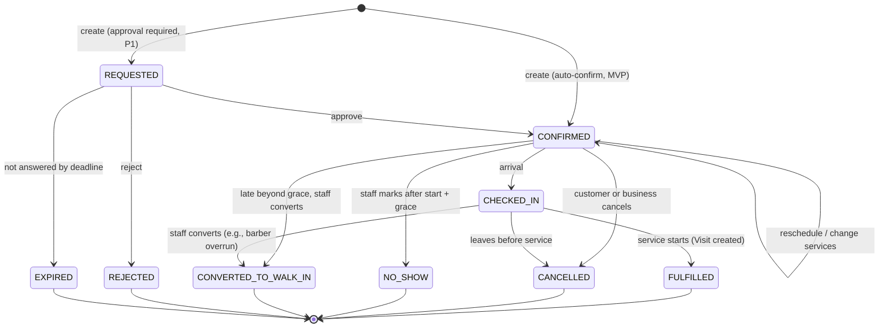

# Booking (Appointment) Lifecycle

Version 0.2 · 2026-10-14 · Status: **Proposed**. Supersedes the draft diagram in [03 §4.4](../03-mvp-and-architecture.md).

> **Changelog v0.2** (audit round 2; see [05 §9](../05-design-review.md)):
> - Branch-closure workflow (§5a, B5).
> - Today's appointment changes follow the queue mutation protocol (B4).
> - Recorded as open decisions: direct start (D-33), converted placement (D-38), and same-day availability during overruns (D-32).

## 1. States

Service progress (in service, completed) lives on the **Visit**, not on the appointment (see [ADR-0004](../adr/0004-separate-appointment-queue-entry-visit.md)).

## 2. Transitions

| From → To | Actor | Guards | Effects (same transaction) | Event |
|---|---|---|---|---|
| ∅ → CONFIRMED | Customer (app/web) or staff | Branch ACTIVE and listed (customers only); services offered at the branch; staff capable of all services; period within working hours and opening hours; ≥ min notice; ≤ horizon; no conflict; customer not blocked; idempotency key new or identical | Insert appointment + service lines (snapshot); insert staff commitment (period + buffer); create/link Customer; store idempotency record | `booking.appointment.confirmed` |
| CONFIRMED → CONFIRMED (reschedule) | Customer (within window) or staff | Same guards as create, for the new period; `reschedule_count < max` (default 3) | Deactivate the old commitment and insert the new one (one statement order, same transaction); update the period. Price snapshot is **kept** unless services change, then re-quoted (BR-13). | `…rescheduled` |
| CONFIRMED → CHECKED_IN | Staff (P0). Customer self check-in for **appointments** is P1. D-36 covers remote queue entries only. | now ≥ start − 60 min (configurable) | Record `checked_in_at`; increment the branch queue `seq` (lanes change) | `…checked_in` |
| CHECKED_IN → FULFILLED | Staff | Staff assigned to the appointment, or manager reassigns; staff has no IN_SERVICE visit | Create the Visit (source = appointment); status FULFILLED | `visit.started` |
| CONFIRMED → FULFILLED | — | **Not allowed in the MVP draft.** Direct start with implicit check-in is **open (D-33)**. Proposed default: allow it, recording `checked_in_at = started_at` and `check_in_method = IMPLICIT`. | — | — |
| CONFIRMED/CHECKED_IN → CANCELLED | Customer | Before start; records `late_cancellation = now > start − cancel_window` | Deactivate the commitment | `…cancelled` |
| CONFIRMED/CHECKED_IN → CANCELLED | Staff (Manager+, or the assigned barber) | Reason required | Deactivate the commitment; notify the customer | `…cancelled` |
| CONFIRMED → NO_SHOW | Staff | now ≥ start + grace | Deactivate the commitment; increment the customer's no-show count | `…no_show` |
| CONFIRMED/CHECKED_IN → CONVERTED_TO_WALK_IN | Staff | now ≥ start + grace (late customer), **or** the barber is overrunning/unavailable and the customer agrees | Deactivate the commitment; create a queue entry (`origin_appointment_id`, presence ARRIVED). The sort key depends on the placement rule, which is **open (D-38)**. | `…converted`, `queue.entry.joined` |

Every transition is a conditional update on `(status, version)`. Zero rows updated → `409 INVALID_STATE` with the current state.

## 3. Policies (per branch, typed, bounded)

| Setting | Default | Bounds | Source |
|---|---|---|---|
| `slot_granularity_min` | 15 | 5–60 | BR-3 |
| `min_notice_min` | 30 | 0–1440 | BR-3 |
| `horizon_days` | 30 | 1–180 | BR-3 |
| `buffer_after_min` | 0 | 0–60 | — |
| `cancel_free_until_min_before` | 120 | 0–2880 | BR-4 |
| `start_grace_min` | 10 | 0–30 | D-4 |
| `max_reschedules` | 3 | 0–10 | — |
| `online_booking_enabled` | true | — | — |
| `approval_required` | false | P1 | FR-BKG-7 |

Policy changes apply only to **new** appointments. Existing appointments store `policy_snapshot` (cancel window, grace) so the rules shown at booking time are the rules enforced.

## 4. Availability computation (read path)

For each `(branch, services[], staff | ANY, date range)`:
1. **Duration** = sum of the resolved durations per staff (they may differ per staff, D-12) + buffer.
2. **Candidate staff** = active staff assigned to the branch who are capable of *all* requested services (D-12b: one barber per appointment).
3. **Free intervals per staff** = (working hours ∩ opening hours, expanded in the branch time zone for those business days, minus exceptions) − active commitments.
4. **Slots** = starts aligned to granularity where `[start, start + duration)` fits, with `start ≥ now + min_notice` and `start ≤ now + horizon`.
5. **ANY:** union of slots across staff. Each slot shows the min–max price over the staff who can take it.

Everything is computed in the **branch IANA zone** (`Africa/Cairo`). DST transitions use the zone rules: a slot that doesn't exist on a spring-forward night is skipped, and the repeated hour on fall-back is resolved by the zone library. Hours are never stored as UTC offsets.

The read path is **advisory**. The write path re-validates everything under constraints.

**Same-day availability during an overrun is open (D-32).** As drafted, slots come from planned commitments only. A slot can be offered for 15 minutes from now while the barber is mid-service and already late. Proposed reversible default (not approved): for today's slots, also exclude intervals before the expected end of the barber's in-progress visit and their CALLED entry.

## 5. Interaction with walk-ins (D-4, resolved)

- A CONFIRMED appointment has priority on its staff member from `start` to `start + grace`.
- **Dispatch rule** for staff member S at time *t*: S may start a walk-in entry E only if `t + expected_duration(E, S) ≤ next_appointment_start(S)`, **or** S has no appointment within that window, **or** a Manager overrides with a reason (audit event).
- A checked-in appointment *before* its start time does not take priority over a walk-in already CALLED.
- If S is overrunning and a checked-in appointment's start + grace passes:
  - Staff may move the appointment to another capable free barber (reassignment = new commitment, same transaction), **or**
  - convert it to a walk-in (placement **open, D-38**; proposed default: front of the line, because the delay is staff-caused), **or**
  - let the customer keep waiting for S.
- The customer is notified of whichever is chosen.

## 5a. Branch closures and reduced hours (B5)

A `BRANCH_CLOSED` exception, or a `BRANCH_SPECIAL_HOURS` exception that removes hours, **must never silently invalidate appointments**. The same applies to a staff member's working-hours reduction.

**Workflow** (Manager+):
1. **Preview** (read-only): the server lists every `CONFIRMED`/`CHECKED_IN` appointment whose period overlaps the time being removed, and for today, the active queue state.
2. **Resolve:** the caller submits the exception **plus an explicit resolution for every affected appointment id**:
   - `CANCEL_BY_BUSINESS` with a reason. Not counted as a customer late cancellation; the customer is notified. **or**
   - `REASSIGN` to another capable staff member at the same time. Allowed only if that staff member is free (the exclusion constraint decides). This is not a closure resolution when the whole branch is closed.
   - Rescheduling to a new time **with the customer's agreement** is P1 (an offer flow). Staff never reschedule without the customer.
3. **Commit** in one transaction:
   - lock the branch row `FOR UPDATE` (and the queue row if it touches today);
   - **recompute the affected set under the lock.** If it differs from the submitted set (a booking arrived meanwhile), roll back with `409 AFFECTED_SET_CHANGED` and a new preview;
   - insert the exception;
   - apply each resolution through the normal appointment transitions;
   - write one `audit_event` per resolution (actor, reason, closure id) and the outbox events (customer notifications).
4. **Rejection:** submitting the exception without resolutions for a non-empty affected set → `409 CLOSURE_HAS_APPOINTMENTS`.

**Race safety:**
- Booking creation takes the branch row `FOR SHARE` and re-checks closures and special hours under it. A closure (`FOR UPDATE`) and a booking therefore cannot interleave unseen.
- Staff time off is additionally backed by the exclusion constraint.

**Detective control:** a daily integrity job flags any active appointment that overlaps a closure or falls outside effective hours. This should never happen; it guards against bugs.

**Policy choice (D-31, provisional):** the default above is "reject until resolved, with optional bulk cancel in the same request". Alternatives are recorded in the decision register: auto-cancel on closure (rejected: silent), or allow the closure and leave appointments pending (rejected: invalid state).

## 6. Concurrency & idempotency (summary)

Details are in [database design §6](../architecture/database-design.md).

- **Double-booking prevention:** a GiST exclusion constraint on `scheduling.staff_commitment (resource_id, period) WHERE active`. Exclusion violation `23P01` → `409 SLOT_UNAVAILABLE`.
- **"ANY":** candidates are ordered deterministically (fewest commitments that day, then staff id). Each attempt runs in a savepoint, and the first successful insert wins.
- **Working-hours and closure races:** the booking transaction takes `FOR SHARE` on the branch row and on the staff member row. Edits to working hours, time off, closures, or special hours take `FOR UPDATE` on the same rows and follow §5a.
- **Today's appointments** (create, reschedule, cancel, check-in, no-show, convert, reassign) also follow the [queue mutation protocol](../architecture/database-design.md), because they change lanes and ETAs.
- **Idempotency:** `Idempotency-Key` header, scoped to (user or membership, key), stored in the same transaction. A replay returns the stored response. The same key with a different payload hash → `422`.

## 7. Notifications

| Event | Customer | Staff |
|---|---|---|
| confirmed / rescheduled / cancelled-by-business | ✔ | assigned barber (in-app) |
| reminder T−24h (if booked > 24h ahead) and T−2h | ✔ | — |
| no-show / converted | ✔ | — |
| cancelled-by-customer | — | assigned barber + front desk |

## 8. Test checklist

- [ ] 50 concurrent creates for the same staff/time → exactly 1 succeeds.
- [ ] ANY with 3 staff, 10 concurrent requests for the same slot → exactly 3 succeed, on 3 different staff.
- [ ] Reschedule into a conflicting slot fails and leaves the original commitment intact.
- [ ] Concurrent reschedule and cancel → one wins; the final state is consistent.
- [ ] Working-hours edit racing a booking → never yields a commitment outside hours.
- [ ] DST: Egypt 2026-04-24 and 2026-10-29/30 boundaries; opening hours crossing midnight.
- [ ] Idempotent replay returns the identical response; a different payload with the same key → 422.
- [ ] Policy snapshot: changing the branch cancel window does not affect existing appointments.
- [ ] A price change after confirmation does not change the appointment total.
- [ ] A closure with affected appointments and no resolutions → 409. A closure with a stale resolution set → 409 `AFFECTED_SET_CHANGED`. A closure with complete resolutions → appointments cancelled or reassigned, audited, and notifications enqueued.
- [ ] A booking concurrent with a closure for the same period → either the booking fails or the closure gets `AFFECTED_SET_CHANGED`; never both succeed silently.
- [ ] Today's appointment changes produce a queue `seq` batch.
