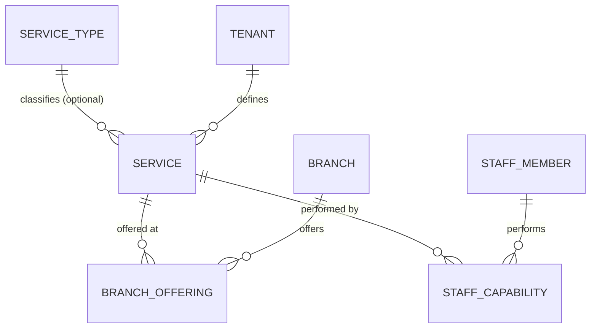
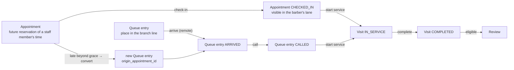

# Domain Model — Barber MVP

Version 0.2 · 2026-10-14 · Status: **Proposed**. Based on the decisions resolved on 2026-10-14 ([04 log](../04-open-decisions.md)), with provisional defaults where noted.

> **Changelog v0.2** (audit round 2; see [05 §9](../05-design-review.md)):
> - Remote queue sessions (B1).
> - Visit ownership and claim invitations kept separate from customer linking and review eligibility (B2).
> - Branch closures (B5).
> - Neutral `PROVIDER` role code (N6).
> - Future-vertical classification (§11).
> - Notifications address customers by record, not raw phone.

Related:
- [Glossary](domain-glossary.md)
- [Booking lifecycle](booking-lifecycle.md)
- [Queue & visit lifecycle](queue-lifecycle.md)
- [Database design](../architecture/database-design.md)

---

## 1. Modules and ownership

| Module (DB schema) | Owns | Scope |
|---|---|---|
| `identity` | User, phone/email identities, sessions, platform role grants, push devices | Platform |
| `tenancy` | Tenant, Business, Branch, Membership, Invitation, Staff member, staff↔branch assignment | Tenant (Tenant/Business rows are platform-visible to admins) |
| `catalog` | Service, Branch offering, Staff capability; platform Service type & Business category | Tenant + platform reference data |
| `scheduling` | Opening hours, Working hours, Schedule exceptions, Staff live status, **Staff commitments** | Tenant |
| `booking` | Appointment, appointment service lines, appointment groups | Tenant |
| `queue` | Queue, **Remote session**, Queue entry, entry service lines, queue event log | Tenant |
| `visit` | Visit, visit service lines, visit corrections, **visit claim invitations, visit claims** | Tenant |
| `crm` | Customer, guardian-consent records | Tenant |
| `review` | Review, Review reply, Content report, Rating aggregates | Tenant-owned, publicly readable through a projection |
| `notification` | Notification, preferences, templates | Platform (with a tenant reference) |
| `discovery` | Branch listing projection | Public, PII-free |
| `platform` | Audit events, outbox, idempotency records, admin access grants | Platform |

Changes from [03 §2.1](../03-mvp-and-architecture.md): `visit` is a separate module, and `crm` replaces the "customer relationships" box.

## 2. Platform identity vs tenant data

```mermaid
erDiagram
  USER ||--o{ USER_PHONE : "verifies"
  USER ||--o{ PLATFORM_ROLE_GRANT : "may hold"
  USER ||--o{ MEMBERSHIP : "works in"
  USER ||--o{ CUSTOMER : "linked as (0..1 per tenant)"
  TENANT ||--|| BUSINESS : "1:1 in MVP"
  TENANT ||--o{ MEMBERSHIP : has
  TENANT ||--o{ CUSTOMER : owns
  BUSINESS }o--|| BUSINESS_CATEGORY : "is a"
  BUSINESS ||--o{ BRANCH : operates
  TENANT ||--o{ STAFF_MEMBER : employs
  MEMBERSHIP |o--o| STAFF_MEMBER : "may be bookable as"
  STAFF_MEMBER ||--o{ STAFF_BRANCH_ASSIGNMENT : "works at"
  BRANCH ||--o{ STAFF_BRANCH_ASSIGNMENT : staffs
  BRANCH ||--|| QUEUE : has
```



**Rules**
- **User ≠ Customer.**
  - A **User** is a person's platform identity.
  - A **Customer** is a business's record of that person. It belongs to the tenant (D-5c) and holds visit history *at that business only*.
  - A Customer row may have no User (a walk-in recorded by name, optionally with a phone; D-6).
  - Each tenant has at most one Customer per User.
- **Membership ≠ Staff member.**
  - A Membership grants permissions: an Owner who never cuts hair has a Membership but no Staff member.
  - A Staff member is a bookable provider. It can exist without a Membership (D-29).
  - A barber who is also a manager has both, linked.
  - Tenant role codes are vertical-neutral: `OWNER`, `MANAGER`, `FRONT_DESK`, `PROVIDER`. The UI labels `PROVIDER` per category ("Barber" / حلاق for barbers). This is a proposed naming change (N6) and changes no permissions.
- **Tenant ≠ Business ≠ Branch.**
  - The **Tenant** isolates and bills.
  - The **Business** is the brand shown in discovery.
  - A **Branch** is a place with coordinates.
  - The **registered business address** (legal, on the Business) is distinct from each **branch location** (a map pin plus an informal address: area, street, landmark). Both are distinct from a **user's temporary search location**, which is never stored with their identity (FR-DIS-5).
- **Independent barber** = a Tenant whose Owner Membership is linked to its only Staff member (D-5). The same User may also be staff at another tenant. The two tenants' data never mix. The MVP does **not** stop a person from being scheduled at two tenants at once: that is an operational issue between those businesses, and cross-tenant availability checks would break isolation.
- **Platform role ≠ Tenant role.** Platform roles never grant tenant data access by themselves. Admin access to tenant data requires a time-boxed, audited access grant (see the [security model](../architecture/tenant-isolation-and-security.md)).

**Branch address model (Egypt).** Fields:
- `governorate`, `city`, `area` (searchable "by area");
- `street_text`, `landmark_text`;
- `location` (a pin confirmed by the owner, then checked by an admin, D-13);
- `location_verified_at`.

The pin is authoritative. Address text is for display.

## 3. Catalog and pricing



**Price & duration resolution** (pure function, unit-tested; D-12):

```
resolve(service, branch, staff?) →
  offering = BranchOffering(branch, service)        -- must exist and be active
  if staff given:
     cap = StaffCapability(staff, service)          -- must exist and be active
     price    = cap.price_override    ?? offering.price_override    ?? service.base_price
     duration = cap.duration_override ?? offering.duration_override ?? service.default_duration
  else ("any barber"):
     range over all eligible active staff at branch → {min_price, max_price, min_dur, max_dur}
```

- Per-staff overrides are allowed only when `business.per_staff_pricing_enabled` is true. The flag defaults to false and the UI is gated (D-12).
- Money is stored as integer minor units (piastres) plus an ISO-4217 currency, `EGP` in the MVP.
- Snapshots also store `tax_inclusive` and `tax_rate_bp` (basis points) for D-20.
- Duration bounds: 5–480 min. Price ≥ 0.
- **Barber departure (M-11).** A Staff member becomes `DEPARTED`:
  - Their capabilities are deactivated.
  - Future appointments must be reassigned or cancelled first; the application blocks departure until this is done.
  - Past visits and reviews stay attached to the staff record, which keeps its display name.
  - Customers stay with the business (D-5c).

## 4. Scheduling

- **Opening hours** and **working hours** are stored in branch-local time as `(weekday, start_minute, duration_minutes)`, so intervals may cross midnight (D-22). Several intervals per day are allowed; gaps between intervals are recurring breaks.
- **Schedule exceptions** are absolute `tstzrange`s with a kind:
  - `BRANCH_CLOSED`
  - `BRANCH_SPECIAL_HOURS` (replaces hours for those days, e.g., Ramadan)
  - `STAFF_TIME_OFF`
- **Staff live status** (`AVAILABLE`, `ON_BREAK`, `UNAVAILABLE`, `OFF_SHIFT`, with optional `expected_back_at`) is operational state for dispatch and ETA. It is **not** used for booking availability, apart from feeding ETA.
- **Staff commitment** is the conflict-checked table:
  - Every confirmed appointment and every `STAFF_TIME_OFF` exception creates one.
  - The database guarantees they never overlap per staff member.
  - Recurring hours are *not* materialized as commitments. The availability engine subtracts commitments from computed hours.
  - Booking checks that the period falls within working hours under a lock (see [database design §6](../architecture/database-design.md)).

## 5. Customers (CRM)

- A Customer is created:
  - when a User first books or joins a queue at the tenant (linked, `acquisition_source` recorded), or
  - when staff record a walk-in **with a phone number** (unlinked).
- Name-only walk-ins do **not** create a Customer. The name lives only on the queue entry and visit (data minimization, D-6).
- **Linking:** an unlinked Customer is linked to a User when that User has *verified* the same phone **and books or joins a queue** at that tenant. Claiming a visit invitation does **not** link the Customer (§7).
- **D-25:** linking changes only *future* attribution. The User sees only visits whose `customer_user_id` was set at creation (after `linked_at`) plus visits they have individually **claimed** (§7). The business sees everything. Phone matching alone never grants access to historical visits, which guards against recycled or shared phones.
- **Phone reuse:** when a phone is verified by a new User, the previous User's `user_phone` row is closed. Existing Customer links stay with the old User id, and new interactions link the new User.
- **Uniqueness:** at most one Customer per (tenant, user) and one per (tenant, phone) among active records.
- **Minors (D-24, legal review pending):**
  - No child accounts.
  - A guardian books or joins with an optional **attendee label**.
  - If the guardian marks the attendee as a child, a `guardian_consent` record is stored (who, when, text version).
  - No birth dates are stored.
- **Groups (D-21):** a `group_id` (uuid) on appointments and staff-created queue entries. "Cancel group" cancels all members that are still active. Each member has its own services, barber preference, ETA, and visit.
- **Remote groups** are represented by a **remote session** ([queue-lifecycle §3](queue-lifecycle.md)). For remote entries, `group_id` = `remote_session_id` (enforced by CHECK), so there is one group concept per remote party.

## 6. Appointment, queue entry, and visit — how they interact

This is the core of the model ([ADR-0004](../adr/0004-separate-appointment-queue-entry-visit.md)).



| Concept | Answers the question | Starts | Ends | Owns |
|---|---|---|---|---|
| **Appointment** | "Is this staff member's time reserved for this person?" | Created/confirmed | `FULFILLED` (a visit started), `CANCELLED`, `NO_SHOW`, `CONVERTED_TO_WALK_IN`, `REJECTED`/`EXPIRED` (P1) | Reserved period, staff commitment, price snapshot, cancellation policy outcome |
| **Queue entry** | "Where is this person in the line, and are they here?" | Join | `SERVED` (a visit started), `CANCELLED`, `NO_SHOW`, `EXPIRED` | Position (sort key), presence, ticket number, ETA inputs, price estimate range |
| **Visit** | "What service was actually delivered?" | Service starts | `COMPLETED` or `VOIDED` | Real start/end, serving staff, final service lines, binding price snapshot, amount charged, payment method |

**Rules**
1. An appointment is **never** stored as a queue entry. When checked in, it appears in its barber's lane through a *query*. The dispatch policy (D-4) considers both kinds of items.
2. A visit is created **only** when service starts. It references exactly one source: an appointment *or* a queue entry (DB check constraint). Each source produces at most one visit (unique indexes).
   - The MVP requires an appointment to be `CHECKED_IN` before service starts. Whether staff may start directly from `CONFIRMED` (implicit check-in) is **open (D-33)**.
3. Starting a visit is **one transaction** that:
   - moves the source to `FULFILLED`/`SERVED`;
   - creates the visit with the binding price snapshot;
   - for an appointment, keeps its commitment as it is: the reserved time stays the historical plan.
4. A "direct serve" (no prior entry) creates a queue entry and its visit in the same transaction, with source `STAFF_DIRECT`. Every visit has a source.
5. A late appointment converted to a walk-in creates a **new** queue entry with `origin_appointment_id`. The appointment ends `CONVERTED_TO_WALK_IN`, and its commitment is released.
6. Only a **COMPLETED** visit can be reviewed, and only by the visit's **owner** (§7): the User recorded on the visit at creation, or the User who claimed that specific visit through its invitation.
7. Analytics read visits for service facts. They read appointments and queue entries only for funnel facts (no-shows, cancellations, waits).

## 7. Visit ownership, claim invitations, and reviews

Three concepts are kept **logically distinct**:

| Concept | Question | Source of truth |
|---|---|---|
| Customer identity | "Which business record is this person?" | `crm.customer` (tenant-owned; may be linked to a User for *future* interactions) |
| Visit ownership | "Which platform User may see this one visit?" | `visit.customer_user_id` (set at creation when the customer was a linked User) **or** a `visit_claim` row for that visit |
| Review eligibility | "May this User review this visit now?" | Visit COMPLETED (not VOIDED) ∧ `now ≤ review_eligible_until` ∧ caller is the visit owner ∧ no review exists for the visit |

**Visit claim invitation** (for completed visits whose customer was not a linked User but has a phone on the Customer record):
1. **Issue:** on `visit.completed`, the worker creates `visit_claim_invitation`:
   - one per visit;
   - a random 128-bit token from a CSPRNG, stored as a SHA-256 hash and never logged; the link carries the token outside the URL path that servers log (fragment or app deep link);
   - `expires_at = review_eligible_until`;
   - a hash of the destination phone;
   - `status ISSUED`.
   The link is sent through the approved notification channel (D-8 open; SMS/WhatsApp provider not yet chosen).
2. **Claim:** the user opens the link, signs in with phone OTP, and the server checks all of these in one transaction:
   - the token hash matches, the invitation is ISSUED and unexpired;
   - the caller's **current verified phone hash equals the destination phone hash** (possession of the message *and* current control of the number);
   - the visit is COMPLETED.
   On success:
   - the invitation → `CLAIMED` (conditional update; single use);
   - a `visit_claim(visit_id UNIQUE, user_id, claimed_at, method = INVITATION)` row is inserted.
3. **Effect:**
   - The claimant can see **that one visit** and review it.
   - No other visit becomes visible, and the Customer record is **not** linked (that needs a later booking/join, §5).
   - Duplicate claims are impossible: `UNIQUE (visit_id)` on claims, plus single-use invitations.
   - Duplicate reviews are impossible: `UNIQUE (visit_id)` on reviews.
   - Claim attempts are rate-limited per user and per IP. Database policies expose only the invitation matching the **presented** token ([security §5.3](../architecture/tenant-isolation-and-security.md)).
4. **Revocation:** a manager may revoke an unclaimed invitation, e.g., the wrong phone was entered (`REVOKED`, audited). Expired invitations → `EXPIRED`.

**Residual identity risks (open, D-30):**
- Shared family phones: another household member holding the phone can claim the visit.
- A recycled number within the 14-day window.
- Disputes ("that wasn't me").

The blast radius is limited to **one visit and one review**. A stronger verification method would require a decision and possibly a provider; none is assumed here.

### Reviews

- `Review(visit_id UNIQUE, author_user_id, branch_id, staff_member_id, rating 1–5, body?, public_display_name, visit_month, status)`.
- It counts toward **branch** and **staff member** aggregates (D-10). A public average is shown only when count ≥ 3.
- **Lifecycle:**
  `SUBMITTED → (automated check) → PUBLISHED | REJECTED_AUTOMATED`
  `PUBLISHED → HIDDEN (reported, severe categories, pending moderation) → PUBLISHED | REMOVED`
  The author can change `PUBLISHED → WITHDRAWN`.
  Edits are allowed within 30 days and are re-checked.
- **One reply** per review, from an Owner/Manager. Lifecycle `PUBLISHED | REMOVED`.
- **Content report** lifecycle: `OPEN → RESOLVED_UPHELD | RESOLVED_DISMISSED`.
- Reviews outlive staff departure. If the customer deletes their account, the review stays with the display name replaced by "Former customer" (legal to confirm, D-18).

## 8. Notifications

- A **Notification** is created by a consumer of a domain event. It has:
  - a recipient: a User, or a tenant **Customer record** for unlinked walk-ins with a phone (D-6). The phone is read from the Customer at send time and never copied into the notification row;
  - a `template_key`, a channel, and a locale;
  - a minimal payload of ids and display values. Phone numbers are copied only into the provider call.
- **Lifecycle:** `PENDING → SENDING → SENT → DELIVERED | FAILED → (retry) …`, or `SUPPRESSED` (preferences, quiet hours, quota, or superseded; e.g., an "ETA changed" message replaced by a newer one).
- `dedupe_key` is unique, e.g., `entry:<id>:called:<seq>`, so retries never double-send.
- Notification failure never affects the domain transaction (FR-NTF-3).
- Push payloads contain no personal data (D-23; [ADR-0005](../adr/0005-hosting-and-data-residency.md)).

## 9. Lifecycles of other important entities

| Entity | States | Notes |
|---|---|---|
| Tenant | `PENDING_VERIFICATION → ACTIVE ⇄ SUSPENDED → CLOSED` | Only ACTIVE tenants with verified businesses are listed. Suspension hides listings and blocks new bookings/joins; existing appointments get a notice. |
| Business verification | `DRAFT → SUBMITTED → VERIFIED \| CHANGES_REQUESTED \| REJECTED` | A material change (name, pin moved > 200 m) sends it back to SUBMITTED. |
| Branch | `DRAFT → ACTIVE ⇄ TEMPORARILY_CLOSED → CLOSED` | CLOSED requires no future appointments. |
| Membership | `INVITED → ACTIVE ⇄ SUSPENDED → REMOVED` | The last ACTIVE OWNER cannot be removed. |
| Staff member | `ACTIVE ⇄ INACTIVE → DEPARTED` | See §3 departure rule. |
| Service | `ACTIVE ⇄ ARCHIVED` | Never hard-deleted (snapshots refer to it). |
| Customer | `ACTIVE → ANONYMIZED` | Anonymized on the user's erasure request or by retention rule. Visits keep only aggregates. |
| User | `ACTIVE ⇄ SUSPENDED → DELETION_REQUESTED → ANONYMIZED` | 30-day grace (D-18). |
| Remote session | `ACTIVE → ENDED` | Ends in the same transaction as the last entry's terminal transition, or on session cancel / expiry / rollover ([queue-lifecycle §3](queue-lifecycle.md)). |
| Visit claim invitation | `ISSUED → CLAIMED \| EXPIRED \| REVOKED` | Single use; expires with review eligibility. |
| Branch schedule exception | created → (active period) → past | A `BRANCH_CLOSED` or hours-reducing `BRANCH_SPECIAL_HOURS` exception that overlaps live appointments cannot be created until every affected appointment has an explicit resolution ([booking-lifecycle §5a](booking-lifecycle.md)). |

## 10. Invariants (summary)

| # | Invariant | Enforced by |
|---|---|---|
| I-1 | Every tenant-owned row references parents of the **same tenant** | Composite FKs `(tenant_id, id)` |
| I-2 | A staff member's planned commitments never overlap | GiST exclusion constraint |
| I-3 | A staff member has at most one IN_SERVICE visit (D-28) | Partial unique index |
| I-4 | A staff member has at most one CALLED queue entry | Partial unique index |
| P-1 | **Product policy (not an invariant):** a user has at most one ACTIVE remote session platform-wide (BR-7, provisional D-3). Changeable by replacing one index. | Partial unique index on `remote_session` |
| I-6 | A visit has exactly one source; a source has at most one visit | CHECK + unique indexes |
| I-7 | One review per visit | Unique index |
| I-8 | Queue state changes are serialized per queue and numbered gap-free | Queue row lock + `seq` |
| I-9 | Snapshots are immutable after creation | No UPDATE grants on snapshot columns + application rule; corrections are new rows |
| I-10 | Tenant data is invisible outside its tenant context | RLS + authorization (not RLS alone) |
| I-11 | A remote entry belongs to a session of the same queue; its group is its session | Composite FK + CHECK |
| I-12 | One claim per visit; one invitation per visit; invitations are single-use | Unique indexes + conditional update |

## 11. Future verticals — what is deliberate now (N6)

| Item | Classification | Note |
|---|---|---|
| Role code `PROVIDER` instead of `BARBER` | **Low-cost neutral naming, done now** (proposed) | UI label per category |
| `staff_commitment.resource_id` | **Low-cost neutral naming, done now** | Still staff-only in the MVP |
| One queue per branch (`UNIQUE (branch_id)`) | **Deliberate MVP limitation** (D-2). Departs from the original brief's "multiple queues". | Entries already reference `queue_id`, so a later change drops one constraint and adds queue routing |
| One IN_SERVICE visit per provider (D-28) | **Deliberate MVP limitation** | Other verticals may need parallel service; this means a schema change |
| Visit source = appointment XOR queue entry | **Deliberate MVP limitation** | A new source type (e.g., referral) means changing the CHECK and adding a column |
| Category-specific policy engines, resources other than staff (rooms, chairs), multi-provider services | **Wait for a real second vertical** | Not designed now. ADR-0001 policy interfaces are the seam. |
