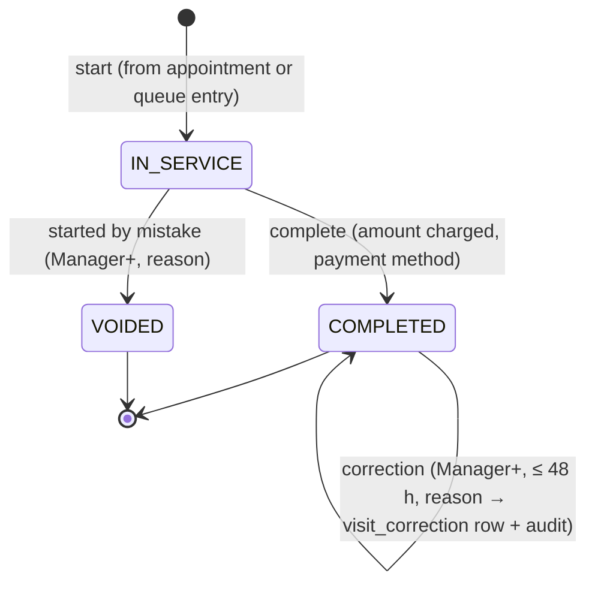

# Queue Entry, Remote Session & Visit Lifecycle

Version 0.2 · 2026-10-14 · Status: **Proposed**. Supersedes the draft diagram in [03 §4.3](../03-mvp-and-architecture.md) and resolves review items C-1, C-2, and C-6.

> **Changelog v0.2** (audit round 2; see [05 §9](../05-design-review.md)):
> - Remote queue **sessions** replace the per-entry remote limit (B1).
> - Every lane-affecting mutation follows one protocol (B4).
> - Arrival confirmation is recorded by actor. Customer self check-in is an open decision (D-36).
> - Converted-appointment placement, `arrive_by` movement, and cooldown scope are recorded as open decisions (D-34, D-35, D-38) instead of being decided here.
> - The business-day rollover is a branch setting, not a queue policy (N5).

## 1. Queue (one per branch, D-2)

| Field | Meaning |
|---|---|
| `intake_status` | `OPEN` · `PAUSED` (no new joins; existing entries continue) · `CLOSED` (outside hours or auto-closed) |
| `seq` | Gap-free counter. Incremented **once per committed transaction** that changes this queue or its lanes ([database design §6.1](../architecture/database-design.md)) |
| `current_business_day` | Local date of the active business day (D-22) |
| `next_ticket_number` | Resets at rollover |

**Policies (typed, bounded; provisional D-3):**

| Setting | Default | Bounds |
|---|---|---|
| `remote_join_enabled` | true | — |
| `max_active_entries` | 40 | 1–200 |
| `max_active_remote_entries` (people, not sessions) | 10 | 0–100 |
| `max_persons_per_remote_session` | 4 | 1–6 |
| `remote_max_distance_km` | null (off) | 0.5–50 |
| `arrival_window_before_eta_min` / `after_eta_min` | 10 / 10 | 0–60 |
| `arrival_tolerance_min` (after `arrive_by`) | 5 | 0–15 |
| `call_grace_min` (time to respond when called) | 3 | 1–15 |
| `max_skips` | 1 | 0–3 |
| `intake_closes_before_close_min` | 30 | 0–180 |
| `remote_cooldown` | 2 expired sessions / 30 days → 7 days without remote join. **Scope is open (D-35).** | bounded |

The business-day rollover is **not** a queue setting. Its single authoritative home is `tenancy.branch.day_rollover_minute` (D-22).

**Intake auto-closes** when either condition holds:
- `now ≥ closing − intake_closes_before_close_min`, or
- the ETA of a new entry would exceed closing time.

This mirrors Great Clips' published behavior ([01](../01-market-research.md) §3).

## 2. Business day (D-22)

- An entry belongs to the business day `[rollover on day D, rollover on day D+1)` in the branch zone. The rollover time comes from the branch setting.
- **Opening intervals must not span the rollover time.** This is a validation rule on opening hours (e.g., a branch open 14:00–04:00 needs rollover ≥ 04:00).
- **At rollover** (one transaction per branch, following the [mutation protocol](../architecture/database-design.md)):
  - every non-terminal entry of the previous day → `EXPIRED` (reason `END_OF_DAY`);
  - their remote sessions end;
  - the ticket number resets;
  - `current_business_day` advances.
- A scheduled job runs this per branch. It is idempotent: it only touches entries whose `business_day <` the current one.

## 3. Remote queue session (product rule P-1)

**Policy, not a domain invariant.** One customer (User) may have **one active remote queue session across the platform** at a time.
- The session belongs to **one branch** and may contain **several linked queue entries** (the customer plus companions/children, D-21).
- Each person has their own entry, position, ETA, and visit.
- The rule exists to limit queue hoarding and remote no-shows (provisional D-3). It can change later (e.g., to one session per branch) by replacing one partial unique index. No other table changes.

| Aspect | Rule |
|---|---|
| Representation | `queue.remote_session(id, tenant_id, queue_id, customer_user_id, customer_id, status, ended_reason, …)`. Every remote entry references its session; the session id is the group id for remote entries (no second group concept). |
| Enforcement | `UNIQUE (customer_user_id) WHERE status = 'ACTIVE'`, platform-wide. Concurrent joins at two branches: one insert wins; the other gets `409 ACTIVE_SESSION_EXISTS` with a link to the existing session. |
| Same-queue integrity | Entries reference the session through a composite FK `(tenant_id, queue_id, remote_session_id)`, so an entry cannot belong to another branch's session. |
| Adding a person | Allowed while the session is ACTIVE, the queue intake is OPEN, and the session is below `max_persons_per_remote_session`. The new entry gets its own `sort_key = now` (it doesn't inherit earlier positions). |
| Release | The session ends **in the same transaction** as the transition that leaves it with no non-terminal entries (all entries SERVED, CANCELLED, NO_SHOW, or EXPIRED). `ended_reason` ∈ {`ALL_ENTRIES_ENDED`, `CANCELLED_BY_CUSTOMER`, `CANCELLED_BY_STAFF`, `EXPIRED`, `END_OF_DAY`}. Once every entry is SERVED, the customer may join elsewhere, even while still in the chair. |
| Cancel session | Cancels all of its non-terminal entries and ends the session in one transaction. |
| Cooldown | Counted per **expired session**, not per entry. The scope (branch / business / platform) is open (D-35). |

## 4. Queue entry: state and presence

State and presence are **separate dimensions** (C-6).

**States:** `WAITING`, `CALLED`, `SERVED` (terminal; a visit exists), `CANCELLED`, `NO_SHOW`, `EXPIRED`
**Presence:** `NOT_ARRIVED` | `ARRIVED`

- Entries created by staff (`STAFF_WALK_IN`, `STAFF_DIRECT`, `CONVERTED_APPOINTMENT`) start with presence `ARRIVED` and `arrival_confirmed_by = STAFF`.
- Remote entries (`REMOTE_APP`, `REMOTE_WEB`) start `NOT_ARRIVED` with an `arrive_by` deadline.
- Every arrival records **who or what confirmed it and when**:
  - `arrival_confirmed_by` ∈ {`STAFF`, `CUSTOMER_SELF`, `KIOSK`};
  - `arrival_confirmed_by_id` (membership or user id);
  - `arrived_at`.

There is no `CHECKED_IN`, `SKIPPED`, `IN_SERVICE`, or `COMPLETED` state on queue entries. Skipping is a counted transition, and service progress belongs to the **Visit** (§6).

```mermaid
stateDiagram-v2
  [*] --> WAITING: join (staff walk-in / remote / converted appointment)
  WAITING --> WAITING: arrive · reorder · transfer barber
  WAITING --> CALLED: call (requires ARRIVED)
  CALLED --> CALLED: recall (re-notify)
  CALLED --> WAITING: skip (not responding; skip_count+1 ≤ max_skips) · hand back
  CALLED --> NO_SHOW: skip when skip_count = max_skips
  CALLED --> SERVED: start service (creates Visit)
  WAITING --> SERVED: direct start (staff, ARRIVED; e.g. barber free, customer seated)
  WAITING --> CANCELLED: customer / staff cancel
  CALLED --> CANCELLED: customer leaves
  WAITING --> EXPIRED: arrive_by + tolerance passed (remote, NOT_ARRIVED) · end of business day
  CALLED --> EXPIRED: end of business day
  SERVED --> [*]
  CANCELLED --> [*]
  NO_SHOW --> [*]
  EXPIRED --> [*]
```

**A late remote customer** (resolves audit B3/FR-QUE-10):
- The entry is `EXPIRED` when still `NOT_ARRIVED` after `arrive_by + arrival_tolerance_min`.
- A remote customer is never `NO_SHOW`. `NO_SHOW` is reserved for an **arrived** customer who doesn't respond when called.

### Transitions

All rows run under the [queue mutation protocol](../architecture/database-design.md): queue lock, conditional update, one `seq`, events, outbox, one transaction.

| Transition | Actor | Guards | Effects |
|---|---|---|---|
| join (remote) | Customer | intake OPEN; remote enabled; below caps; no ACTIVE session elsewhere (P-1) **or** adding to own ACTIVE session at this queue; not in cooldown (D-35); not blocked; optional distance check (stores pass/fail only) | Create the session if needed; own Customer row ([security §5.3](../architecture/tenant-isolation-and-security.md)); ticket number; `sort_key = now`; `arrive_by` from ETA; services snapshot; price **range** |
| join (staff walk-in) | Staff | intake OPEN or staff override; name required, phone optional (D-6) | Customer row only if a phone is given; presence ARRIVED |
| arrive | **Staff** (P0). **Customer self-confirmation: PROPOSED P0, not approved (D-36).** Kiosk: P1. | state WAITING; presence NOT_ARRIVED; now ≤ `arrive_by + tolerance`; for customer self-confirmation, the entry belongs to the caller's own active session | `arrived_at`, `arrival_confirmed_by(_id)` |
| call | Staff S (for self) or front desk (for S) | entry ARRIVED and WAITING; S eligible (capable, preferred = S or ANY); S has no CALLED entry (I-4) and no IN_SERVICE visit (I-3); S status AVAILABLE; **D-4 fit rule** passes or manager override (audited) | `assigned_staff_id = S`; `called_at`; notify the customer |
| recall | Staff | CALLED | re-notify; `recall_count+1`. Doesn't change position. |
| skip | Staff | CALLED and `now ≥ called_at + call_grace` | if `skip_count < max_skips`: back to WAITING with the sort key moved back (default: after the next 2 arrived entries), else NO_SHOW |
| hand back | Staff | CALLED | back to WAITING at the original sort key; no skip counted (e.g., barber becomes unavailable) |
| start | Staff S | CALLED by S (or WAITING + ARRIVED for direct start); S has no IN_SERVICE visit (I-3) | Entry → SERVED; **Visit created** with the binding price snapshot for S (D-26); session release check |
| cancel | Customer (own entry or whole session) / Staff | non-terminal | reason; notify; session release check |
| reorder | Manager+ | WAITING | new `sort_key`; **audit event** with reason (BR-8) |
| transfer | Staff | WAITING | change `preferred_staff_id` (or ANY); recompute price range |
| expire | System | remote NOT_ARRIVED past `arrive_by + tolerance`, or end of day | notify the customer (a pre-expiry warning was already sent at `arrive_by − 5 min`); cooldown counter (per expired session); session release check |

### Ordering and dispatch

- **Order** = `sort_key` ascending among `WAITING` entries. `sort_key` is a timestamp-like value.
- **Converted appointments:** where they enter the line is **open (D-38)**. Proposed defaults, not approved:
  - late customer → `sort_key` = the original appointment start;
  - barber overrun (staff-caused) → front of the line.
- **Remote entries keep their place while NOT_ARRIVED until `arrive_by`.**
  - If they reach the head before arriving, dispatch **skips over them without penalty** and calls the next ARRIVED entry.
  - They keep relative priority once they arrive (provisional detail of D-3; to be validated in the concierge test A4).
  - Whether `arrive_by` moves when the ETA grows is **open (D-34)**. Proposed default: extend-only, with notification; never shortened.
- **Barber preference:** an entry with `preferred_staff_id = S` is eligible only for S. ANY entries are eligible for any capable staff. For staff S, "call next" chooses the first eligible ARRIVED entry by `sort_key`, subject to the D-4 fit rule against S's next appointment.
- **Checked-in appointments** whose start time has arrived take precedence over queue entries for their assigned barber (D-4). The staff board shows them at the top of that barber's lane.

## 5. ETA (v1, rule-based)

The ETA is computed at read time from a consistent snapshot, never stored as truth. Each entry caches its last notified ETA (`last_notified_eta_at`) so notifications fire only on significant changes.

1. For each staff member S who is AVAILABLE (or returning before closing):
   - `free_at(S)` = max(now, `staff_live_status.expected_free_at`). That field is maintained under the queue protocol when a visit starts or completes, and recomputed at read time as `max(started_at + expected_duration, now + 2 min)` to handle overruns. Customer-side ETA reads never need visit rows ([security §5.3](../architecture/tenant-isolation-and-security.md)).
   - Blocked intervals = S's upcoming appointments (checked-in or confirmed).
2. Simulate in `sort_key` order:
   - Assign each WAITING entry to the eligible staff member with the earliest feasible start: no overlap with appointments, and the D-4 fit rule.
   - Advance that staff member's `free_at` by the entry's expected duration for S.
3. **Expected duration** comes from the staff's resolved duration. When ≥ 30 completed visits exist for (staff, service) in the last 60 days, use their **median** actual duration instead (Waitwhile's documented "historical" approach uses a similar threshold; [01](../01-market-research.md) source 16).
4. **Display:** a range `[p, p + spread]` where spread = max(5 min, 20% of p). Rounded to 5 min. Shown as "about 25–30 min".
5. **Notify** when the ETA moves by ≥ 5 min (max one per 10 min), at "≈ 15 min left" (configurable), and on call.

ETA accuracy is logged for each served entry: predicted at join vs actual call time. This feeds the validation metric G4.

## 6. Visit lifecycle

The **only** visit states are `IN_SERVICE`, `COMPLETED`, and `VOIDED`. Visits are never `CANCELLED` or `NO_SHOW`; those outcomes belong to appointments and queue entries.

- **Start:** a binding snapshot of services, durations, and price for the serving staff member.
- **Complete:**
  - `amount_charged_minor` (may differ from the snapshot; e.g., a discount given in the shop), `payment_method` (`CASH`, `CARD`, `WALLET`, `OTHER`, `UNRECORDED`), final service lines (a service added mid-visit is allowed).
  - `review_eligible_until` = completed_at + 14 days (D-10).
  - Issues a **visit review invitation** if the customer is reachable ([domain-model §7](domain-model.md)).
  - Frees the barber's lane, so it follows the queue mutation protocol.
- **Void** does not restore the source: it stays SERVED/FULFILLED. A voided visit is an operational correction, and the manager re-adds the person if needed. This keeps history append-only. It follows the queue mutation protocol.
- **Corrections** never overwrite the snapshot. They add a `visit_correction` row (price, payment method, service lines only), and reports use the corrected values. They don't affect lanes, so they take no queue lock.

## 7. Mutations that follow the queue protocol

These all run under the [queue mutation protocol](../architecture/database-design.md), on the branch's queue for its **current business day**:
- **Queue entries:** create (any source), arrive, call, recall, skip, hand back, start, cancel, expire, reorder, transfer.
- **Remote sessions:** create, add person, cancel.
- **Visits:** start, complete, void.
- **Staff live status:** AVAILABLE / ON_BREAK / UNAVAILABLE / OFF_SHIFT.
- **Today's appointments:** create, reschedule, cancel, check-in, no-show, convert, reassign.
- **Today's schedule:** working-hours or time-off changes for today; branch closures or special hours that touch today.
- **Queue settings:** intake open/pause/close; queue policy changes; catalog duration changes that alter today's ETAs (emitted as one `queue.config_changed` event; clients refetch).
- **Rollover.**

## 8. Scenario behavior (brief requirement §9)

| Scenario | Behavior |
|---|---|
| Haircut takes longer than expected | The expected end extends (`now + 2 min` floor). Downstream ETAs shift, and notifications fire only on ≥ 5 min changes. If the barber's next appointment will be late, the staff board shows a warning, and the appointment customer can be sent a "running ~N min late" message. Appointment delay is computed, not stored. Same-day *new* bookings during an overrun are open (D-32). |
| Barber becomes unavailable | Live status UNAVAILABLE (+ expected back), via the protocol. Their CALLED entry, if any, is **handed back** to WAITING at its original sort key. Entries that **prefer** that barber are notified with choices: keep waiting / switch to any / cancel. Their appointments are flagged for reassignment. ANY entries simply re-flow in the ETA simulation. |
| Customer cancels | Entry CANCELLED; session released if it was the last active entry. Others' ETAs recompute, and notifications go out per the threshold rule. |
| Customer misses turn | CALLED → (call grace) → skip → back to WAITING once (default), then NO_SHOW. |
| Appointment arrives while walk-ins wait | It takes its barber at start time (+ grace). Walk-ins are not started on that barber if they wouldn't fit (D-4). ANY walk-ins flow to other barbers. |
| Customer joins multiple queues | A second **remote session** anywhere on the platform is rejected (P-1) with `409 ACTIVE_SESSION_EXISTS`. Companions join through the *same* session. A customer with an appointment may join a queue elsewhere. Staff may still add the person as a walk-in in-shop (they are physically present). |
| Two employees serve the same entry | The conditional update on `(state, version)` under the queue lock lets one succeed; the other gets `409 INVALID_STATE`. I-3/I-4 also prevent a barber from holding two. |
| Network interruption | See §9. |
| A remote customer arrives after `arrive_by` | Within `arrival_tolerance_min` staff can still mark them arrived. After EXPIRED, staff can re-add them as a walk-in (new entry, back of the line). |
| Barber goes on break with a CALLED customer | Blocked: the barber must start, skip, or hand back the CALLED entry first. |

## 9. Client consistency and recovery

- Each committed transaction produces **one** `seq` value and 1..n `queue_event` rows (`seq`, `idx`). Clients apply a whole `seq` batch atomically.
- **Events are published only after commit**: the outbox relay reads committed rows. Rolled-back transactions consume no `seq`, because the increment rolls back with them. Clients therefore never see events for changes that didn't happen.
- **Client rules:**
  - `seq ≤ lastSeq` → duplicate; ignore.
  - `seq = lastSeq + 1` → apply.
  - `seq > lastSeq + 1` → hold for up to 1 s for the missing batch, then request replay `GET …/events?afterSeq=lastSeq`. The server replays if within 500 batches or 1 h, otherwise returns a snapshot.
- **Heartbeats** (every 15 s) carry the queue's current **committed** `seq`, so a client detects a gap even when a NOTIFY or push was lost and no further events arrive ([database-design §8.1](../architecture/database-design.md)).
- **Snapshots** are read in one `REPEATABLE READ, READ ONLY` transaction (queue row + entries + lanes + `seq`), so the snapshot and its `seq` are consistent.
- **Commands are idempotent:**
  - creation commands use `Idempotency-Key`;
  - state transitions carry the expected `version`, so a retry after success returns `409 INVALID_STATE` together with the current state. If that state shows the client's own action was applied (e.g., `assigned_staff_id` = the caller), clients treat it as success.
- The staff UI shows "offline — last updated hh:mm" after 20 s without a heartbeat and disables commands that require fresh state.

## 10. Public displays and privacy (BR-10)

- The customer app shows the user's own entries (their session), ticket numbers, the number of people ahead, and the ETA. It never shows other people's names.
  - The session **organizer** sees all of the session's companions: every party row in a remote session carries the organizer's account.
- Walk-ins without an account have no self-service view in the MVP. They get updates through SMS/WhatsApp if a phone was given, or in the shop. An account-less status link is open (D-40).
- **The shop TV display (P1) shows ticket numbers and the called barber's display name only. No customer names or initials.** This is authoritative; FR-QUE-11 matches it.
- The staff board shows names, and phone numbers only to Manager+ and Front-desk (masked for the `PROVIDER` role).

## 11. Test checklist

- [ ] Every transition in the table; illegal transitions → 409.
- [ ] Concurrent call/start on the same entry by 2 staff → exactly 1 success.
- [ ] A barber cannot hold two CALLED entries or two IN_SERVICE visits.
- [ ] Remote sessions:
  - [ ] the same user opening sessions at 2 branches concurrently → exactly 1 success;
  - [ ] a group of 3 within one session succeeds;
  - [ ] a 5th person beyond the cap → 409;
  - [ ] the session ends exactly when its last entry becomes terminal (each terminal path tested), and the user can then open a new session.
- [ ] Composite FK: an entry cannot reference a session of another queue or tenant.
- [ ] A late remote customer → EXPIRED, never NO_SHOW.
- [ ] End-of-day rollover across midnight-crossing hours; DST nights; opening hours spanning the rollover are rejected.
- [ ] `seq`:
  - [ ] increments once per committed transaction (multi-entry group cancel = one `seq`, several `idx`);
  - [ ] rolled-back commands leave no gap;
  - [ ] replay and snapshot recovery yield an identical state;
  - [ ] visit completion and staff status changes produce `seq` batches.
- [ ] Fit rule: a walk-in that would overlap the next appointment is not callable without an override (and the override writes an audit event).
- [ ] ETA simulation unit tests: overruns, a barber unavailable, preferred barber, appointments interleaved.
